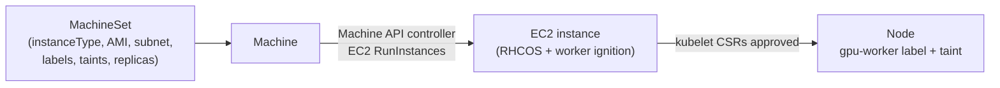

# AWS OpenShift GPU Nodes via MachineSet

**Verified against:** OpenShift 4.22.18 (IPI on AWS), RHOAI-Toolkit
(Oct-Nov 2026 commits), `g6e.12xlarge`. Driver setup (NFD + NVIDIA GPU
Operator) is **not** covered here; see "Next: drivers" below.

Prerequisite: a running IPI cluster -- see
[aws-openshift-install](../aws-openshift-install/SKILL.md).

## When a MachineSet applies



On **AWS IPI** the cluster creates its own nodes: you declare a MachineSet,
and the in-cluster Machine API controller launches the EC2 instance, boots
it with the worker ignition config, and the node joins on its own. There's
no separate `aws ec2 run-instances` step, and you don't "add the node then
tell OpenShift about it". `replicas: 1` launches it, `replicas: 0`
terminates it, and a dead instance gets replaced.

On **bare metal / on-prem** clusters (Agent-based, Assisted, UPI) there's
usually no Machine API provider, so no MachineSets: the server is booted with RHCOS + worker ignition (or
`oc adm node-image create`), CSRs are approved by hand, then the node is
labeled and tainted manually. Check which case you're in:

```bash
oc get infrastructure cluster -o jsonpath='{.status.platformStatus.type}{"\n"}'
# AWS -> MachineSets work. None/External -> join nodes by hand.
# BareMetal -> MachineSets possible via BareMetalHost.
oc get machinesets -n openshift-machine-api
```

### Why a separate GPU MachineSet

A MachineSet has one template, so every machine it creates has the same
instance type, AZ, labels and taints. The installer's worker MachineSets
(`<infra-id>-worker-<az>`, e.g. `m6a.4xlarge`) can't produce GPU nodes.
A dedicated GPU MachineSet differs from a worker one only in:
`machine-role`/`machine-type` label values of `gpu-worker`, the label
`node-role.kubernetes.io/gpu-worker: ''`, the taint
`nvidia.com/gpu:NoSchedule` (keeps non-GPU pods off the expensive node),
the `instanceType`, and the `machine.openshift.io/GPU|vCPU|memoryMb`
annotations. Being separate also lets you scale GPU capacity to 0 without
touching the workers, and pin it to an AZ that offers the GPU type.

## Step 1: Pre-checks (AZ, quota, price)

```bash
export AWS_PROFILE=<profile> REGION=<region> T=g6e.12xlarge
# Which AZs offer it? Must be an AZ where the cluster has a private subnet.
aws ec2 describe-instance-type-offerings --region $REGION --location-type availability-zone \
  --filters Name=instance-type,Values=$T --query 'InstanceTypeOfferings[].Location' --output text
# GPU count / vCPU / RAM
aws ec2 describe-instance-types --region $REGION --instance-types $T \
  --query 'InstanceTypes[0].[GpuInfo.Gpus[0].Count,GpuInfo.Gpus[0].Name,VCpuInfo.DefaultVCpus,MemoryInfo.SizeInMiB]' --output text
# G/VT on-demand vCPU quota (g4/g5/g6/g6e share it; p5 uses L-417A185B)
aws service-quotas get-service-quota --region $REGION --service-code ec2 --quota-code L-DB2E81BA \
  --query 'Quota.Value'
# On-demand $/hr
aws pricing get-products --region us-east-1 --service-code AmazonEC2 --filters \
  Type=TERM_MATCH,Field=instanceType,Value=$T Type=TERM_MATCH,Field=regionCode,Value=$REGION \
  Type=TERM_MATCH,Field=operatingSystem,Value=Linux Type=TERM_MATCH,Field=tenancy,Value=Shared \
  Type=TERM_MATCH,Field=preInstalledSw,Value=NA Type=TERM_MATCH,Field=capacitystatus,Value=Used \
  --query 'PriceList[0]' --output text | jq -r '.terms.OnDemand[].priceDimensions[].pricePerUnit.USD'
```

Sandbox accounts can have a G/VT quota as low as 64 vCPU, which fits only
one `g6e.12xlarge` (48 vCPU). Multi-GPU sizes are often offered in fewer
AZs than the 1-GPU sizes, so check before choosing the AZ.

### GPU instance types (from `describe-instance-types`)

| Type | GPUs per node | vCPU | RAM |
|---|---|---|---|
| `g6.xlarge`/`2xlarge`/`4xlarge`/`8xlarge`/`16xlarge` | 1x L4 (24 GB) | 4/8/16/32/64 | 16/32/64/128/256 GiB |
| `g6.12xlarge` / `24xlarge` / `48xlarge` | 4x / 4x / 8x L4 | 48/96/192 | 192/384/768 GiB |
| `g6e.xlarge`/`2xlarge`/`4xlarge`/`8xlarge`/`16xlarge` | 1x L40S (48 GB) | 4/8/16/32/64 | 32/64/128/256/512 GiB |
| `g6e.12xlarge` / `24xlarge` / `48xlarge` | 4x / 4x / 8x L40S | 48/96/192 | 384/768/1536 GiB |
| `p5.4xlarge` | 1x H100 (80 GB) | 16 | 256 GiB |
| `p5.48xlarge` | 8x H100 | 192 | 2048 GiB |

`--replicas N` on a 1-GPU type gives **N nodes with 1 GPU each**: a single
pod can't use them together (no tensor parallelism across them). For N GPUs
on **one** node, pick a multi-GPU size. There's no 2-GPU size in these
families: to mimic a 2-GPU server, use a 4-GPU node and expose 2 (see
"Next: drivers").

## Step 2: Generate the MachineSet YAML

The toolkit generator clones AMI, IAM profile, security groups and subnet
from the first worker MachineSet. It's fully non-interactive once
`--instance-type` is given.

**Listed types** (`g6.xlarge|2xlarge|4xlarge`, `g6e.xlarge|2xlarge|4xlarge`,
`p5.4xlarge`, `p5.48xlarge`, `p5en.48xlarge`):

```bash
cd third_party/rhoai-toolkit
./scripts/create-gpu-machineset.sh --instance-type g6e.4xlarge --az <az> --replicas 1 --volume-size 200 --apply
# other flags: --spot, --spot-max-price <price>
```

With `--apply` it also creates the toolkit's `gpu-cluster-policy` if the
GPU Operator CRD already exists, and deletes the generated YAML.

**Unlisted types** (e.g. `g6e.12xlarge`): the script exits with
`Invalid instance type`. Generate a listed type's YAML **without
`--apply`**, then change the type and the 3 sizing annotations. The script
writes the YAML to the **current directory** and it holds cluster-specific
IDs, so run it from a gitignored directory:

```bash
cd <gitignored-dir>
<repo>/third_party/rhoai-toolkit/scripts/create-gpu-machineset.sh \
  --instance-type g6e.4xlarge --az <az> --replicas 1 --volume-size 200 < /dev/null
sed 's/g6e\.4xlarge/g6e.12xlarge/g' gpu-machineset-g6e.4xlarge-<az>.yaml \
  | sed "s/machine.openshift.io\/GPU: '1'/machine.openshift.io\/GPU: '4'/; s/vCPU: '16'/vCPU: '48'/; s/memoryMb: '65536'/memoryMb: '393216'/" \
  > gpu-machineset-g6e.12xlarge-<az>.yaml && rm gpu-machineset-g6e.4xlarge-<az>.yaml
grep -nE 'name:|instanceType|GPU|vCPU|memoryMb|availabilityZone|volumeSize' gpu-machineset-g6e.12xlarge-<az>.yaml
```

The first `sed` also renames the MachineSet, its selector and labels
(`<infra-id>-gpu-worker-g6e.12xlarge-<az>`). The script's g6e.4xlarge
annotations are GPU `1`, vCPU `16`, memoryMb `65536`.

Before applying, compare the generated `securityGroups` and `subnet` filters
with the real worker MachineSet; the script hardcodes the
`<infra-id>-node` / `<infra-id>-lb` SG names:

```bash
oc get machineset <infra-id>-worker-<az> -n openshift-machine-api -o json \
  | jq -c '.spec.template.spec.providerSpec.value | {securityGroups, subnet, ami, iamInstanceProfile}'
```

## Step 3: Launch and watch

```bash
oc apply -f gpu-machineset-<type>-<az>.yaml
oc get machines -n openshift-machine-api -w        # Provisioning -> Provisioned -> Running
oc get csr --no-headers | grep -i pending | awk '{print $1}' | xargs -r oc adm certificate approve
oc get nodes -l node-role.kubernetes.io/gpu-worker -L node.kubernetes.io/instance-type,topology.kubernetes.io/zone
```

Observed for `g6e.12xlarge`: Provisioning -> Running in 3.5 min, node Ready
about 1 min later (~5 min total).

- **`InsufficientInstanceCapacity`** in `oc describe machine <name>`: AWS
  has no capacity in that AZ right now. Delete the failed Machine, change
  `placement.availabilityZone` and the subnet filter to another AZ that
  offers the type (copy the subnet from that AZ's worker MachineSet), and
  re-apply.
- **Quota exceeded** (`VcpuLimitExceeded`): request an increase for
  `L-DB2E81BA` (G/VT) or `L-417A185B` (P), or pick a smaller size.

### Check the hardware (no drivers needed)

```bash
oc debug node/<gpu-node> -q -- chroot /host sh -c 'lspci -nn | grep -i nvidia; lspci -tv | grep -i nvidia'
```

Expect one line per GPU (L40S = `10de:26b9`). The tree shows the PCIe
layout: on `g6e.12xlarge` each of the 4 L40S sits on its own root port (no
NVLink, no shared switch), so every GPU pair is equivalent for TP=2.

## Day 2: cost and teardown

```bash
oc scale machineset <name> -n openshift-machine-api --replicas=0   # terminates the EC2; stops billing
oc scale machineset <name> -n openshift-machine-api --replicas=1   # brand-new EC2; drivers reinstall
```

Or keep the Machine and stop/start the EC2 instance with the toolkit's
`third_party/rhoai-toolkit/scripts/manage-gpu-nodes.sh stop|start` (not
exercised while writing this skill).

`openshift-install destroy cluster` also removes GPU instances, since
Machine-created EC2s carry the `kubernetes.io/cluster/<infra-id>: owned`
tag. To remove only the GPU node, delete its MachineSet:
`oc delete machineset <name> -n openshift-machine-api`.

## Next: drivers

The node joins `Ready` but advertises no `nvidia.com/gpu` until NFD labels
it (`feature.node.kubernetes.io/pci-10de.present=true`) and the NVIDIA GPU
Operator's `ClusterPolicy` deploys the driver and device plugin. Follow
[openshift-ai-setup](../openshift-ai-setup/SKILL.md), and
[rhoai-toolkit-nfd-instance-missing](../rhoai-toolkit-nfd-instance-missing/SKILL.md)
if the NFD instance is missing. Points noticed while preparing that step:

- The toolkit's `lib/manifests/operators/gpu-operator.yaml` subscribes to
  channel `stable`. In the 4.22 `certified-operators` catalog both `stable`
  and the default channel `v26.7` point to `gpu-operator-certified.v26.7.2`,
  so the manifest can be applied as-is. Check with
  `oc get packagemanifest gpu-operator-certified -n openshift-marketplace -o jsonpath='{range .status.channels[*]}{.name}={.currentCSV}{"\n"}{end}'`.
- **Untested -- exposing fewer GPUs than the node has** (e.g. 2 of 4 to
  mimic a 2-GPU server): add to the `ClusterPolicy`
  ```yaml
  spec:
    devicePlugin:
      env:
        - name: NVIDIA_VISIBLE_DEVICES
          value: "0,1"
  ```
  and check that the node's allocatable `nvidia.com/gpu` is `2`. CDI is
  enabled in the toolkit `ClusterPolicy` and may bypass the variable. If
  you still see 4, remove it and run a pinned pause pod that requests the
  extra GPUs. GFD's `nvidia.com/gpu.count` label and DCGM metrics still show
  all GPUs either way.
