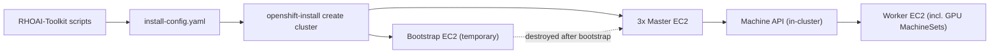

# AWS OpenShift Install (IPI) via RHOAI-Toolkit

**Verified against:** OpenShift 4.22.18, RHOAI-Toolkit (Oct-Nov 2026
commits), `openshift-install`/`oc` 4.22.18, AWS provider. Confirm your own
versions with `oc version`, `./openshift-install version`, and
`git -C third_party/rhoai-toolkit log -1` before assuming behavior matches exactly.

## Overview

RHOAI-Toolkit wraps the standard OpenShift IPI installer (`openshift-install`)
with interactive prompts and saved configuration. IPI means the installer
creates and owns all AWS infrastructure itself (VPC, subnets, load balancers,
EC2 instances, IAM, Route53 records) from a single `install-config.yaml` --
no Terraform/CloudFormation involved.



## Step 1: Prerequisites

```bash
aws sts get-caller-identity                                    # verify credentials
aws route53 list-hosted-zones --query 'HostedZones[].[Name,Id]' --output table   # find baseDomain
```

You need: a public Route53 hosted zone (this becomes `baseDomain`), a Red Hat
pull secret (`~/.openshift/pull-secret.json`, get one at
https://console.redhat.com/openshift/install/pull-secret), and an SSH
public key (any `~/.ssh/*.pub` works -- it doesn't have to be `id_rsa.pub`).

Toolkit pre-flight check (interactive; prompts for region and may ask
"Continue anyway? [y/N]" on warnings -- not scriptable as-is):
```bash
cd third_party/rhoai-toolkit && ./scripts/check-aws-prerequisites.sh
```

For non-interactive verification, run the underlying checks directly: AWS
CLI/credentials (`aws sts get-caller-identity`), region validity
(`aws ec2 describe-regions --region <region>`), no conflicting private
hosted zones matching `*openshift-cluster*`, VPC/EIP quota headroom
(`aws ec2 describe-vpcs` / `describe-addresses` count vs. default quota of
5), and no pre-existing `*openshift*`-tagged EC2 instances.

## Step 2: Check instance type availability in your target region

Not every AWS region has every instance type. Before picking masters/workers
and GPU types, verify:
```bash
for t in m6a.4xlarge g6e.xlarge g6e.2xlarge g6e.4xlarge; do
  echo "$t: $(aws ec2 describe-instance-type-offerings --location-type availability-zone \
    --region <region> --filters Name=instance-type,Values=$t \
    --query 'InstanceTypeOfferings[].Location' --output text)"
done
```

## Step 3: Download `openshift-install` -- watch out for slow networks

The binary is ~400-450MB, downloaded from
`https://mirror.openshift.com/pub/openshift-v4/clients/ocp/<version>/openshift-install-<platform>.tar.gz`
(`<version>` e.g. `4.22.18`; `<platform>` is `mac-arm64`, `mac`, or `linux`).
Get the latest patch for a channel via:
```bash
curl -s https://mirror.openshift.com/pub/openshift-v4/clients/ocp/stable-4.22/release.txt | grep '^Name:'
```

**If downloading locally is impractically slow** (e.g. a sandboxed/rate-limited
network measuring under ~1MB/s -- observed ~150KB/s sustained, timing out at
only 6% of a 413MB file after 3 minutes), don't wait it out. Instead launch a
small **temporary bastion EC2 instance inside the target AWS account** and
download/install from there -- AWS-to-AWS network routinely hits 20-30MB/s
(observed: the same ~450MB file downloaded in 14.5s at 30.8MB/s, roughly
200x faster). This also sidesteps the fact that the toolkit's full installer
script (`scripts/openshift-installer-master.sh`) is a ~1900-line interactive
script that blocks on stdin and isn't automatable non-interactively.

### Bastion pattern (reusable for any slow-network environment)

1. Find or create a public subnet:
   ```bash
   aws ec2 describe-vpcs --region <region> --filters Name=is-default,Values=true --query 'Vpcs[0].VpcId' --output text
   ```
   If no default VPC exists, create a minimal one: VPC (`create-vpc`) ->
   subnet with `--map-public-ip-on-launch` (`create-subnet` +
   `modify-subnet-attribute`) -> Internet Gateway (`create-internet-gateway`
   + `attach-internet-gateway`) -> route table with a `0.0.0.0/0` route to
   the IGW (`create-route-table` + `create-route` + `associate-route-table`).
2. Import your local SSH key as an EC2 key pair (reused for both bastion
   access and the cluster's `sshKey`):
   ```bash
   aws ec2 import-key-pair --region <region> --key-name bastion-key --public-key-material fileb://~/.ssh/<key>.pub
   ```
3. Create a security group allowing inbound SSH (22) **only from your
   current public IP** (`curl -s https://checkip.amazonaws.com`), all
   outbound.
4. Launch an Amazon Linux 2023 `t3.medium` with that key/SG/subnet and
   `--associate-public-ip-address`. It only orchestrates API calls -- the
   actual cluster nodes are separate EC2 instances the installer creates in
   its own VPC.
5. `scp` over `~/.aws/credentials`, the pull secret, and the SSH public key.
   On the bastion, write `~/.aws/config` with the target region, download
   `openshift-install-linux.tar.gz`, extract, `chmod +x`.
6. Generate `install-config.yaml` on the bastion (see Step 4) and run the
   install there (see Step 5).
7. Once `auth/kubeconfig` and `auth/kubeadmin-password` are retrieved via
   `scp`, **terminate the bastion** -- it is not needed again. All later `oc`
   and AWS CLI commands work directly from your local machine since the API
   server and console are public endpoints.
   ```bash
   aws ec2 terminate-instances --region <region> --instance-ids <id>
   aws ec2 delete-security-group --region <region> --group-id <sg-id>   # after termination completes
   aws ec2 delete-key-pair --region <region> --key-name bastion-key
   ```

## Step 4: `install-config.yaml`

This is what the toolkit's `generate_install_config()` function
([`scripts/openshift-installer-master.sh:1332`](../../../third_party/rhoai-toolkit/scripts/openshift-installer-master.sh))
produces -- generate it directly for non-interactive/scripted installs:

```yaml
apiVersion: v1
baseDomain: <base-domain>              # must match an existing Route53 public hosted zone
metadata:
  name: <cluster-name>
platform:
  aws:
    region: <region>
compute:
- name: worker
  platform:
    aws:
      type: <worker-instance-type>     # e.g. m6a.4xlarge
      zones: [<az1>, <az2>, <az3>]
  replicas: <worker-count>
controlPlane:
  name: master
  platform:
    aws:
      type: <master-instance-type>
      zones: [<az1>, <az2>, <az3>]
  replicas: <master-count>             # 3 for HA
networking:
  clusterNetwork:
  - cidr: 10.128.0.0/14
    hostPrefix: 23
  machineNetwork:
  - cidr: 10.0.0.0/16                  # only needed when reusing an existing VPC
  networkType: OVNKubernetes
  serviceNetwork:
  - 172.30.0.0/16
pullSecret: '<contents of pull-secret.json>'
sshKey: '<contents of id_*.pub>'
```

Back it up (`cp install-config.yaml install-config.yaml.backup`) --
`openshift-install` consumes and deletes it from the install directory.

## Step 5: Run the install

```bash
nohup ./openshift-install create cluster --dir=<cluster-name>-install --log-level=info > install.log 2>&1 &
tail -f install.log   # or poll periodically; takes 30-45 minutes (observed: 40m17s for a 3-master/3-worker m6a.4xlarge cluster)
```

If running this over SSH on the bastion (not in a local agent/automation
shell), plain `nohup ... & disown` is sufficient and survives SSH session
drops, since the process lives on the remote host independent of your local
shell/tool lifecycle.

### What happens under the hood (IPI bootstrap lifecycle)

1. Creates a VPC, 3 public + 3 private subnets (one pair per AZ), an
   Internet Gateway, and a NAT Gateway per AZ (via AWS SDK calls driven by
   an embedded Cluster API provider -- not literal CloudFormation, though
   older installer versions used CFN stacks).
2. Creates security groups: master (API 6443, Machine Config Server 22623,
   VXLAN 4789, Geneve 6081, host services 9000-9999, SSH 22), worker (same
   minus API/MCS), and a temporary bootstrap SG.
3. Creates IAM instance profiles: master (ec2, ELB, Route53, S3), worker
   (ec2, ELB).
4. Creates a Network Load Balancer for the API (6443) and Machine Config
   Server (22623), and a Classic ELB for the router/ingress (80/443) with
   health checks against the router's `healthCheckNodePort`.
5. Creates Route53 records: `api.<cluster>.<domain>` and
   `api-int.<cluster>.<domain>` -> NLB, `*.apps.<cluster>.<domain>` ->
   Classic ELB.
6. Launches a **temporary** bootstrap EC2 instance with an ignition config
   containing a throwaway etcd + API server, used only to bring up the
   first masters.
7. Launches the master EC2 instances; they fetch their full ignition config
   from the bootstrap node's Machine Config Server, form an etcd quorum,
   and take over the API server.
8. The bootstrap instance is destroyed once masters report ready.
9. The in-cluster **Machine API** controller (now running on masters) reads
   `Machine`/`MachineSet` objects and provisions the worker EC2 instances --
   workers are never created directly by `openshift-install` itself.
10. Workers join by requesting kubelet client CSRs, approved automatically
    by the `machine-approver` operator; each node then requests a
    kubelet-serving CSR as a follow-on.

### Post-install credentials

- `auth/kubeconfig` -- client-certificate auth straight to the API server;
  bypasses OAuth/the router entirely, so it works even if the console is
  down.
- `auth/kubeadmin-password` -- generated locally by the installer, **never**
  stored in AWS.

## Step 6: Approve CSRs (don't skip this)

If `machine-approver` stalls (it sometimes does), a backlog of unapproved
kubelet CSRs freezes kubelet<->API-server trust cluster-wide, which can
cascade into the router's cloud LB health check failing (console/OAuth
become unreachable while the API stays up). See
[openshift-csr-backlog-outage](../openshift-csr-backlog-outage/SKILL.md) for
the full diagnosis/fix if this happens after the fact. Proactively, right
after install:

```bash
export KUBECONFIG=<install-dir>/auth/kubeconfig
oc get csr --no-headers | grep -i pending | awk '{print $1}' | xargs -r oc adm certificate approve
oc get nodes
oc get co   # all ClusterOperators should be Available
```

## Step 7: Add GPU worker nodes

```bash
cd third_party/rhoai-toolkit
./scripts/create-gpu-machineset.sh --instance-type <type> --replicas <n> --apply
# other flags: --spot, --spot-max-price <price>, --az <zone>, --volume-size <gb>
```

GPU instance type reference (AWS):

| Type | GPU | vCPU | RAM |
|---|---|---|---|
| `g6.xlarge`/`2xlarge`/`4xlarge` | 1x NVIDIA L4 (24GB) | 4/8/16 | 16/32/64 GB |
| `g6e.xlarge`/`2xlarge`/`4xlarge` | 1x NVIDIA L40S (48GB) | 4/8/16 | 16/32/64 GB |
| `p5.4xlarge` | 1x NVIDIA H100 (80GB) | 16 | 256 GB |
| `p5.48xlarge` | 8x NVIDIA H100 | 192 | 2048 GB |

Each instance has exactly 1 GPU except the `.48xlarge` sizes -- to get N
GPUs on single-GPU instance types, set `--replicas N`.

### What a GPU MachineSet actually is

A `MachineSet` is a declarative EC2 instance template (AMI, instance type,
subnet, security groups, IAM profile -- in its `providerSpec`) living in
`openshift-machine-api`. A GPU MachineSet differs from a regular worker's
only in: `machine-role`/`machine-type` label values of `gpu-worker`, an
added label `node-role.kubernetes.io/gpu-worker: ''`, a taint
`nvidia.com/gpu:NoSchedule` (so only GPU-tolerating pods schedule there),
and the `instanceType` field. The Machine API controller reconciles
`MachineSet -> Machine -> EC2 instance -> Node` the same way for any
MachineSet, GPU or not.

```bash
oc get machines -n openshift-machine-api -w
oc get nodes -l node-role.kubernetes.io/gpu-worker
```

Day-2: stop/start the underlying EC2 instances (without deleting the
Machine objects, for cost savings) with
`./scripts/manage-gpu-nodes.sh stop|start`.

Adding a GPU MachineSet is only half the story -- the node won't actually
advertise `nvidia.com/gpu` as schedulable until NFD labels it and the GPU
Operator's `ClusterPolicy` reconciles. If `ClusterPolicy` stays `notReady`
with "No NFD labels found" even though the node is `Ready`, see
[rhoai-toolkit-nfd-instance-missing](../rhoai-toolkit-nfd-instance-missing/SKILL.md).

## Common failure modes

- **Route53 propagation delay**: DNS TTL can cause transient lookup
  failures right after record creation; retry rather than assume failure.
- **Insufficient service quota**: vCPU-per-instance-family limits can block
  the masters/workers from launching; check in Service Quotas console.
- **VPC/EIP limits**: default is 5 of each; check via
  `aws ec2 describe-vpcs`/`describe-addresses` count before installing.
- **GPU instance unavailable in chosen AZ**: verify with
  `describe-instance-type-offerings` (Step 2) *before* generating
  `install-config.yaml`, since master/worker AZs and GPU AZs must overlap.

## Next step

Once the cluster and GPU nodes are up, install Red Hat OpenShift AI -- see
[openshift-ai-setup](../openshift-ai-setup/SKILL.md).
