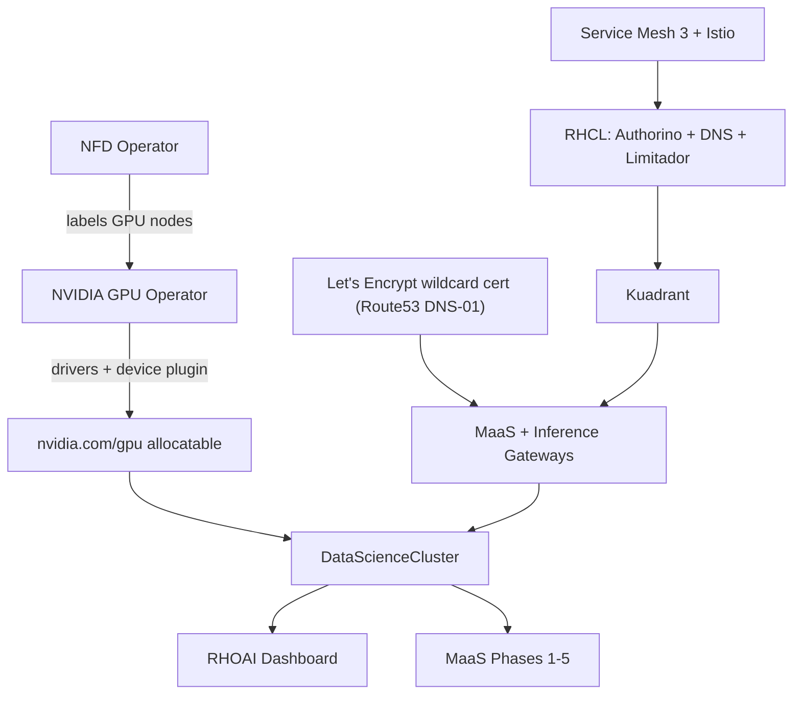

# OpenShift AI (RHOAI) + Full MaaS Setup via RHOAI-Toolkit

**Verified against:** see frontmatter. Confirm your own versions with
`oc get clusterversion`, `oc get csv -A | grep -E 'rhods|gpu-operator|rhcl'`,
and the toolkit's `RHOAI_VERSION_LABEL`/`RHOAI_MAX_VALIDATED_OCP` constants
in `scripts/install-rhoai-{33,34,35}.sh` before assuming behavior matches
exactly -- RHOAI changes substantially between minor versions (see that
script's top-of-file changelog comment block).

## Overview

A single operator, GPU Operator, does **not** know which nodes have GPUs on
its own -- it depends on NFD (Node Feature Discovery) to label them first.
Likewise RHOAI's Model-as-a-Service (MaaS) depends on a whole chain of
infra being set up first: Service Mesh -> RHCL (Kuadrant/Authorino/Limitador)
-> Istio -> Gateway API -> TLS. `install-rhoai-35.sh` orchestrates all of
this in one script, in a specific dependency order.



Prerequisite: a running OpenShift cluster, ideally with GPU worker nodes
already provisioned -- see
[aws-openshift-install](../aws-openshift-install/SKILL.md) for the cluster
and [aws-openshift-gpu-machineset](../aws-openshift-gpu-machineset/SKILL.md)
for GPU nodes.

## Step 1: Run the installer

```bash
cd third_party/rhoai-toolkit
export KUBECONFIG=<install-dir>/auth/kubeconfig
./scripts/install-rhoai-35.sh --channel stable-3.5
# or via Makefile: make setup-rhoai-35 (no flag control)
```

Key flags (full list in `--help`):
- `--skip-rhcl` / `--skip-maas`: skip RHCL/Kuadrant/Gateway/MaaS entirely
  (NFD + GPU Operator + RHOAI dashboard/serving only -- much faster, ~10-15
  min instead of ~25-35 min)
- `--no-llmd`: skip the LWS operator (llm-d distributed inference)
- `--skip-admin-user`: don't prompt for/create an htpasswd `admin` user
- `--skip-node-scaling`: skip the toolkit's own worker-count auto-scaling
  (use if you already provisioned workers/GPU nodes yourself)
- `--channel <channel>`: pin the RHOAI OLM channel (e.g. `stable-3.5`) to
  skip the interactive channel picker
- `--domain <domain>`: **must be the full apps domain**
  `<cluster-name>.<base-domain>` (e.g. `rhoai-demo.example.com`),
  **not** just the Route53 base domain -- getting this wrong silently
  misconfigures every MaaS/Gateway hostname (see
  [rhoai-maas-gateway-wrong-domain](../rhoai-maas-gateway-wrong-domain/SKILL.md)).
  When unsure, omit the flag and let auto-detection handle it.

The script is **not fully non-interactive** even with flags -- expect at
least these prompts unless bypassed:
1. `Create admin user? (Y/n)` -- skip with `--skip-admin-user`
2. If no RHOAI channel pinned: a numbered channel picker -- skip with `--channel`
3. **Let's Encrypt TLS setup** (only if no `ClusterIssuer` exists yet and RHCL/MaaS aren't skipped) -- four prompts in sequence:
   `Use these credentials? [Y/n]` (reuses your AWS CLI creds for Route53 DNS-01)
   → `Select [1]:` (1=Production real certs, 2=Staging test certs)
   → `ACME contact email [admin@<domain>]:` (Enter accepts the default)
   → `Proceed? [Y/n]`

### Running long, prompt-laden scripts non-interactively

`nohup ./script.sh &` backgrounded in a local automation/agent shell can get
killed when that shell's tool-call session ends, even with `disown` --
depends on your execution environment. If background jobs keep dying
partway through, wrap the whole thing in `screen` (or `tmux` if available)
instead, which fully detaches into its own session:

```bash
screen -dmS rhoai-install bash -c './scripts/install-rhoai-35.sh ... > install.log 2>&1; echo DONE_$? >> install.log'
# later, answer a stuck prompt without attaching interactively:
screen -S rhoai-install -p 0 -X stuff $'Y\n'
tail -f install.log   # or just re-check periodically
```

## Step 2: What gets installed, in order

Each operator follows the same OLM pattern: a `Subscription` resolves to a
`ClusterServiceVersion` (CSV), which deploys the operator's Deployment +
RBAC + CRDs; the operator then reconciles whatever custom resource you (or
the script) create.

1. **NFD** (`openshift-nfd`) -- `NodeFeatureDiscovery` CR -> `nfd-worker`
   DaemonSet on every non-master node -> labels nodes with
   `feature.node.kubernetes.io/pci-10de.present=true` for any NVIDIA PCI
   device (`10de` = NVIDIA's vendor ID). **If GPU nodes were added after
   NFD, confirm this CR actually exists** -- a common toolkit gap is
   covered in
   [rhoai-toolkit-nfd-instance-missing](../rhoai-toolkit-nfd-instance-missing/SKILL.md).
2. **NVIDIA GPU Operator** (`nvidia-gpu-operator`) -- creates CRD
   `clusterpolicies.nvidia.com`, then a `ClusterPolicy` CR (deferred if no
   GPU nodes are NFD-labeled yet) that cascades into DaemonSets, scheduled
   only on GPU-labeled nodes:

   | DaemonSet | Purpose |
   |---|---|
   | `nvidia-driver-daemonset` | Compiles/loads the NVIDIA kernel driver |
   | `nvidia-container-toolkit-daemonset` | Container runtime GPU hook |
   | `nvidia-device-plugin-daemonset` | Registers `nvidia.com/gpu` with kubelet |
   | `nvidia-dcgm` / `nvidia-dcgm-exporter` | GPU metrics hostengine + Prometheus exporter |
   | `gpu-feature-discovery` | Fine-grained labels (GPU model, CUDA/driver version) |
   | `nvidia-node-status-exporter` | Node-level NVIDIA status metrics |

   A transient `nvidia-dcgm-exporter` `CrashLoopBackOff` (`error connecting
   to nv-hostengine`) in the first 1-2 minutes is a normal startup race with
   its paired `nvidia-dcgm` pod -- self-resolves once that pod is
   `1/1 Running`.
3. **Kueue** (`openshift-operators`) -- quota/fair-scheduling for GPU
   workloads across teams.
4. **cert-manager** (`cert-manager-operator`) -- required for both the
   wildcard Let's Encrypt cert and RHCL's internal TLS.
5. **LWS / LeaderWorkerSet** (`openshift-lws-operator`, skipped with
   `--no-llmd`) -- multi-pod leader/worker groups for llm-d distributed
   inference.
6. **Wildcard TLS** -- creates a `letsencrypt-prod` `ClusterIssuer` (Route53
   DNS-01 solver using your AWS credentials) and a `default-gateway-tls`
   Certificate for `*.<apps-domain>`, applied to the Gateway API resources,
   the IngressController (best-effort -- confirm this actually landed, see
   [openshift-console-self-signed-cert](../openshift-console-self-signed-cert/SKILL.md)),
   and KServe.
7. **RHCL stack** (if MaaS/RHCL not skipped) -- **this is "MaaS Phase 1"**:
   - OpenShift Service Mesh 3 Operator (its own InstallPlan needs manual
     approval even with `installPlanApproval: Automatic` on some channels
     -- the script approves it explicitly)
   - RHCL operator, which itself installs 3 sub-operators: Authorino,
     DNS operator, Limitador
   - `AUTH_SERVICE_TIMEOUT=2s` patched onto the RHCL subscription
   - `kuadrant-system` namespace + `Kuadrant` instance CR
   - Istio: `IstioCNI` + `Istio` instance in `istio-system`, plus the
     `openshift-default` `GatewayClass`
   - Kuadrant operator restarted so it detects the now-ready Istio
   - Authorino TLS configured via OpenShift's `service-ca` (not
     cert-manager)
8. **MaaS Phase 2: Gateway + namespace labels** -- creates the
   `maas-default-gateway` `Gateway` (Gateway API, not a plain Route),
   a 2Gi-memory `ConfigMap` for its Envoy proxy (prevents an OOM issue),
   a passthrough `Route` for it, and labels namespaces so
   `AllowedRoutes`-selector routing works. Also creates a second, separate
   `openshift-ai-inference` Gateway for direct model access outside MaaS
   governance (no auth/rate-limiting).
9. **RHOAI operator** (`redhat-ods-operator`) -- channel resolved by
   `get_rhoai_channel()`/`select_rhoai_channel()` (tries
   `stable-<version>`, falls back to `fast-<major>.x`, then cluster
   default) -> creates `DSCInitialization` (cluster-wide settings) and
   `DataScienceCluster` (component toggles: `dashboard`, `workbenches`,
   `kserve`, `datasciencepipelines`, `modelregistry`, `ogx` in 3.5+,
   `mcplifecycleoperator`, etc., each `Managed`/`Removed`). Waits for
   `AIGatewayReady` condition (requires the Phase 1-2 gateway infra above).
10. **Dashboard features** -- patches `OdhDashboardConfig` with flags like
    `modelAsService`, `genAiStudio`, `mcpCatalog`, `gpuaas`, etc.
11. **Hardware profile + MLflow** -- a default GPU `HardwareProfile` CR, and
    an `Mlflow` CR (SQLite-backed, exposed at `<dashboard>/mlflow`).
12. **MaaS Phases 3-5** (delegated to `scripts/setup-maas.sh`, the single
    source of truth for MaaS logic):
    - **Phase 3: PostgreSQL** -- a POC Postgres Deployment +
      `maas-db-config`/`postgres-creds` Secrets in
      `redhat-ai-gateway-infra` (**not for production** -- swap for RDS/
      Crunchy/Azure Database before going live)
    - **Phase 4: Enable MaaS in the DataScienceCluster** -- flips the MaaS
      component to `Managed` and waits for reconciliation
    - **Phase 5: Verify** -- checks `maas-api`/`maas-controller`/
      `ai-gateway-operator` deployments are rolled out, `ModelsAsAServiceReady`
      is `True`, the `MaasTenantConfig` is `Ready`, MaaS CRDs exist (8
      kinds under `maas.opendatahub.io`), and restarts the gateway pods to
      clear any stale WASM shim state if its health check is inconclusive
      right after install (this is expected on a fresh gateway -- don't
      treat an "inconclusive" health check here as a failure on its own)
    - Redis-backed Limitador (rate-limiting) is configured in the same
      pass, with `EnvoyFilter`s for health checks and timeout fixes
13. **Observability** -- Tempo Operator + OpenTelemetry Operator + Cluster
    Observability Operator (all required by DSCI's monitoring/tracing
    config) + Perses dashboards + native Observe-tab dashboards.

## Step 3: Verify

```bash
# GPU
oc get nodes -l node-role.kubernetes.io/gpu-worker \
  -o jsonpath='{range .items[*]}{.metadata.name}{": "}{.status.allocatable.nvidia\.com/gpu}{"\n"}{end}'
oc get clusterpolicy gpu-cluster-policy -o jsonpath='{.status.state}'   # ready
oc debug node/<gpu-node> -- chroot /host nvidia-smi                     # confirm GPU model/memory

# RHOAI core
oc get datasciencecluster default-dsc -o jsonpath='{.status.phase}'    # Ready
oc get csv -A | grep -Ev 'Succeeded|NAME'                               # should be empty

# MaaS
oc get maastenantconfig -A                                              # True / Reconciled
oc get gateway -n openshift-ingress                                     # PROGRAMMED=True
curl -sk -o /dev/null -w "%{http_code}\n" "https://maas.<apps-domain>/"
curl -sk -o /dev/null -w "%{http_code}\n" "https://inference-gateway.<apps-domain>/"
# a real HTTP code (even 404 -- no model published yet) means DNS+TLS+routing are correct;
# a connection failure means the domain is wrong, see the fix skill referenced above

# Dashboard
oc get route data-science-gateway -n redhat-ods-applications -o jsonpath='{.spec.host}'
curl -sk -o /dev/null -w "%{http_code}\n" "https://<that-host>/"       # 301/302 (OAuth redirect) is healthy
```

Dashboard URL pattern: `https://rh-ai.apps.<cluster>.<domain>/` (the
`data-science-gateway` route 301-redirects here). Log in with `kubeadmin` or
any cluster OAuth user -- RHOAI doesn't require its own separate login.

## MaaS next steps (not automated by the installer)

The installer only stands up MaaS *infrastructure*; publishing an actual
model is a separate manual flow:
1. Deploy a model via the dashboard (creates a `MaaSModelRef`)
2. Create a MaaS Subscription (dashboard Settings > Subscriptions)
3. Create a MaaS Authorization Policy (dashboard Settings > Authorization
   Policies)
4. Generate API keys
5. Verify: `oc get tenant -n models-as-a-service`,
   `oc get maassubscriptions -n models-as-a-service`

## Troubleshooting

- **Console/dashboard shows "Not Secure" / untrusted certificate in the
  browser**: the wildcard-TLS step's `IngressController` patch is
  best-effort and can silently fail -- see
  [openshift-console-self-signed-cert](../openshift-console-self-signed-cert/SKILL.md).
- **`ClusterPolicy` stuck on `NFDLabelsMissing`**: see
  [rhoai-toolkit-nfd-instance-missing](../rhoai-toolkit-nfd-instance-missing/SKILL.md).
- **MaaS/inference Gateway unreachable (connection failure, not 404)**: see
  [rhoai-maas-gateway-wrong-domain](../rhoai-maas-gateway-wrong-domain/SKILL.md).
- **RHOAI subscription stuck in `UpgradePending`**: check
  `oc get installplan -n redhat-ods-operator` for an unapproved plan.
- **Dashboard route 503/unreachable but API healthy**: confirm the
  cluster's router/ingress is healthy overall, not just this route -- see
  [openshift-csr-backlog-outage](../openshift-csr-backlog-outage/SKILL.md).
- **Service Mesh / RHCL InstallPlan never progresses**: these operators'
  subscriptions sometimes need their `InstallPlan` approved explicitly even
  under `Automatic` approval on certain OLM catalog configurations -- check
  `oc get installplan -A | grep -v Approved` and approve manually if stuck
  (`oc patch installplan <name> -n <ns> --type=merge -p '{"spec":{"approved":true}}'`).
