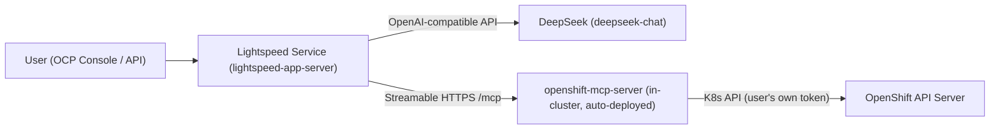

# OpenShift Lightspeed + DeepSeek + MCP Server

## Overview

As of `lightspeed-operator` v2.0.0+, the operator deploys Lightspeed as a
suite of components in `openshift-lightspeed`, including a **built-in
"MCP server for Red Hat OpenShift"** (`openshift-mcp-server` Deployment +
Service). The operator automatically wires this MCP server into the
running `olsconfig.yaml` with Kubernetes-token auth — **no manual MCP
server deployment (Helm) or `OLSConfig.spec.mcpServers` patch is needed**.
This supersedes older docs that describe a separate Tech Preview
`MCPServer` feature gate / manual `mcpServers` list — check
`oc get olsconfig cluster -o jsonpath='{.status.conditions}'` for an
`MCPServerReady` condition to confirm this behavior on your operator
version before falling back to the manual steps in "Older/manual MCP
wiring" below.

## Architecture



## Step 1: Login

```bash
oc login --token=<token> --server=<api-url> --insecure-skip-tls-verify
oc whoami && oc get clusterversion && oc get nodes
```

## Step 2: Remove an existing Lightspeed install (if present)

Check first — don't assume it exists:

```bash
oc get olsconfig cluster 2>&1          # "doesn't have a resource type" = CRD not installed, nothing to remove
oc get namespace openshift-lightspeed 2>&1
oc get subscription,csv -n openshift-lightspeed 2>&1
```

If present, remove in this order:

```bash
oc delete olsconfig cluster --ignore-not-found
oc delete subscription lightspeed-operator -n openshift-lightspeed --ignore-not-found
oc delete csv -n openshift-lightspeed \
  -l operators.coreos.com/lightspeed-operator.openshift-lightspeed= --ignore-not-found
oc delete namespace openshift-lightspeed --ignore-not-found
```

## Step 3: Install the operator

Find the package (usually in `redhat-operators`):

```bash
oc get packagemanifest lightspeed-operator -n openshift-marketplace \
  -o jsonpath='{.status.defaultChannel}{"\n"}'
```

```bash
oc create namespace openshift-lightspeed

cat <<'EOF' | oc apply -f -
apiVersion: operators.coreos.com/v1
kind: OperatorGroup
metadata:
  name: openshift-lightspeed
  namespace: openshift-lightspeed
spec:
  targetNamespaces: [openshift-lightspeed]
---
apiVersion: operators.coreos.com/v1alpha1
kind: Subscription
metadata:
  name: lightspeed-operator
  namespace: openshift-lightspeed
spec:
  channel: stable
  name: lightspeed-operator
  source: redhat-operators
  sourceNamespace: openshift-marketplace
  installPlanApproval: Automatic
EOF
```

Wait for `oc get csv -n openshift-lightspeed` to show `PHASE: Succeeded`.

## Step 4: Configure DeepSeek as the LLM provider

DeepSeek is OpenAI-compatible (`type: openai`, base URL
`https://api.deepseek.com/v1`). The `models[].name` can be `deepseek-chat`
even though DeepSeek's backend now serves it as `deepseek-flash` — it's
accepted as a legacy alias.

```bash
oc create secret generic credentials -n openshift-lightspeed \
  --from-literal=apitoken=<DEEPSEEK_API_KEY>
```

> The secret key **must be named `apitoken`** (CRD default via
> `credentialKey`) unless you set `credentialKey` explicitly in the
> provider spec.

```yaml
apiVersion: ols.openshift.io/v1alpha1
kind: OLSConfig
metadata:
  name: cluster
spec:
  llm:
    providers:
      - name: deepseek
        type: openai
        url: "https://api.deepseek.com/v1"
        credentialsSecretRef:
          name: credentials
        models:
          - name: deepseek-chat
  ols:
    defaultProvider: deepseek
    defaultModel: deepseek-chat
    logLevel: INFO
    deployment:
      replicas: 1
```

**Validate the key BEFORE applying**, independent of the cluster — a bad
key will otherwise silently keep the `lightspeed-app-server` pod stuck at
`1/2 Ready` forever (readiness probe hits `/readiness`, which runs an LLM
health check):

```bash
curl -s -o /dev/null -w "%{http_code}\n" https://api.deepseek.com/chat/completions \
  -H "Content-Type: application/json" \
  -H "Authorization: Bearer $DEEPSEEK_API_KEY" \
  -d '{"model":"deepseek-chat","messages":[{"role":"user","content":"hi"}]}'
# 200 = good. 401 "is invalid" = bad key (often missing the sk-... prefix).
```

If you update the secret after the fact, restart the pod to pick it up:

```bash
oc delete pod -n openshift-lightspeed -l app.kubernetes.io/name=lightspeed-service-api
```

## Step 5: Wait for all pods and verify

```bash
oc get pods -n openshift-lightspeed -w
```

Expect 8 pods: `lightspeed-app-server` (2/2), `lightspeed-agentic-operator-controller-manager`,
`lightspeed-operator-controller-manager`, `lightspeed-console-plugin`,
`lightspeed-otel-collector` (2/2), `lightspeed-postgres-server`,
`lightspeed-rhokp`, and `openshift-mcp-server` (1/1) — this last one is
the built-in MCP server, deployed automatically.

Image pulls for `lightspeed-app-server` (~5GB) and `lightspeed-rhokp`
(~10GB, offline knowledge portal/Solr) can take several minutes on first
install — this is normal, not a hang. `lightspeed-app-server` also waits
on `rhokp`'s Solr port before its main container finishes starting.

Confirm health:

```bash
oc get olsconfig cluster -o jsonpath='{range .status.conditions[*]}{.type}{"="}{.status}{" "}{end}'
# Look for: MCPServerReady=True RHOKPReady=True ApiReady=True CacheReady=True
```

> `AgenticConsolePluginReady`/`AlertsAdapterReady` will show `False`
> ("requires OpenShift 5.0 or newer") on OCP 4.x clusters — that's
> expected and does not block MCP tool-calling or the basic chat plugin.

## Step 6: Confirm Lightspeed → MCP wiring

```bash
oc get deployment,svc -n openshift-lightspeed openshift-mcp-server
CM=$(oc get cm -n openshift-lightspeed -o name | grep olsconfig | head -1)
oc get $CM -n openshift-lightspeed -o jsonpath='{.data.olsconfig\.yaml}' | grep -A5 "^mcp_servers:"
```

Expect:

```yaml
mcp_servers:
- headers:
    Authorization: kubernetes   # passes the calling user's own k8s token
  name: openshift
  timeout: 60
  url: https://openshift-mcp-server.openshift-lightspeed.svc:8443/mcp
```

## Step 7: Test cluster debugging end-to-end

Port-forward and query the `/v1/query` API directly (bypasses needing a
route/console):

```bash
oc port-forward -n openshift-lightspeed svc/lightspeed-app-server 8443:8443 &
PF_PID=$!
sleep 4
TOKEN=$(oc whoami -t)
curl -sk https://127.0.0.1:8443/v1/query \
  -H "Authorization: Bearer $TOKEN" -H "Content-Type: application/json" \
  -d '{"query":"Use your tools to list pods that are not Running across all namespaces and check ClusterOperator health."}' \
  --max-time 90
kill $PF_PID
```

A working setup returns `tool_calls` in the JSON response (e.g.
`pods_list`, `resources_list` for `ClusterOperator`, `namespaces_list`)
with real cluster data in `tool_results`/the final `response` text — proof
DeepSeek is deciding to call the OpenShift MCP tools to answer. In the
OpenShift web console, the same works via the Lightspeed chat panel
(`Help → OpenShift Lightspeed`, or the sidebar if `ConsolePluginReady`).

## Troubleshooting

- **`lightspeed-app-server` stuck at `1/2 Ready`**: check
  `oc logs -n openshift-lightspeed -l app.kubernetes.io/name=lightspeed-service-api -c lightspeed-service-api --tail=50 | grep -i "LLM connection"`.
  `LLM connection check failed` + `401` = bad API key, fix the secret and
  restart the pod. `LLM connection checked - LLM is ready` = healthy.
- **Image pulls take a long time**: `lightspeed-app-server` and
  `lightspeed-rhokp` images are multi-GB; this is normal on first install.
- **`oc` commands intermittently fail with `TLS handshake timeout`**:
  transient — just retry.

## Older/manual MCP wiring (pre-v2.0.0 operator, or standalone MCP server)

If your operator version does **not** auto-manage an MCP server (no
`MCPServerReady` condition on `OLSConfig`), you can wire one in manually:

1. Deploy the MCP server via Helm:
   `helm upgrade -i openshift-mcp-server -n openshift-lightspeed --create-namespace oci://ghcr.io/openshift/charts/openshift-mcp-server --set openshift=true --set config.port=8080 --set config.stateless=true`
2. Grant it read access:
   `oc create clusterrolebinding mcp-server-view --clusterrole=view --serviceaccount=openshift-lightspeed:openshift-mcp-server`
3. Patch `OLSConfig` to add the feature gate and server entry:

```bash
oc patch olsconfig cluster --type='merge' -p '{
  "spec": {
    "featureGates": ["MCPServer"],
    "mcpServers": [{
      "name": "openshift-mcp",
      "streamableHTTP": {"url": "http://openshift-mcp-server.openshift-lightspeed.svc:8080/mcp", "timeout": 30},
      "valueFrom": {"type": "kubernetes"}
    }]
  }
}'
```

4. Verify: `oc logs -n openshift-lightspeed deployment/lightspeed-app-server | grep -i "mcp servers provided\|loaded tools"`
