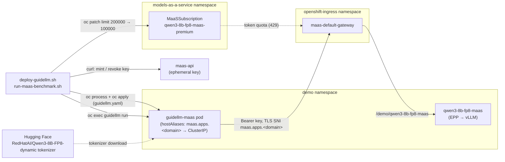

# GuideLLM benchmark through the MaaS gateway

A minimal, hardcoded example: benchmark the LLMInferenceService `demo/qwen3-8b-fp8-maas`
through the MaaS gateway with GuideLLM 0.7.1, using plain `oc` commands and one YAML file.
For the generic, configurable version see
[misc/guidellm-maas-gateway-benchmark](../../misc/guidellm-maas-gateway-benchmark/SKILL.md).

## Architecture



## Files

| file | what it does |
|---|---|
| `guidellm.yaml` | OpenShift Template for `deploy/guidellm-maas`; the gateway hostname and ClusterIP are parameters |
| `deploy-guidellm.sh` | Looks up the gateway hostname and ClusterIP, then `oc process \| oc apply` |
| `run-maas-benchmark.sh` | Raises the token limit, mints a key, runs GuideLLM, saves `results/gateway.json`, revokes the key, restores the limit |

## Run

From the repo root, logged in with `oc` as a cluster admin (`jq` and `curl` installed):

```bash
examples/guidellm-maas/deploy-guidellm.sh
examples/guidellm-maas/run-maas-benchmark.sh   # ~3 min; console tables + results/gateway.json
```

The workload is 100 requests of 768 prompt / 768 output tokens at concurrency 8.
That needs ~153,600 tokens, so the run raises the subscription limit from
100,000 to 200,000 per hour, which **applies to every user of the subscription**
until the script restores it.

## Cleanup

```bash
oc delete deploy/guidellm-maas -n demo
```
