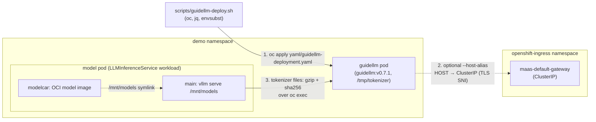

# Deploy the GuideLLM client pod

**Last updated:** 2026-11-04 · **Based on:** OpenShift 4.22.18, RHOAI 3.5.2,
GuideLLM 0.7.1 (`ghcr.io/vllm-project/guidellm:v0.7.1`, official upstream image).

Script: [`scripts/guidellm-deploy.sh`](../../scripts/guidellm-deploy.sh) (`-h` for help).
Manifest: [`yaml/guidellm-deployment.yaml`](../../yaml/guidellm-deployment.yaml).

## Architecture



## Deploy

From the repo root:

```bash
export NAMESPACE=demo LLMISVC=qwen3-8b-fp8-maas   # model to copy the tokenizer from

scripts/guidellm-deploy.sh                        # raw vLLM benchmarks
scripts/guidellm-deploy.sh --host-alias HOST=IP   # gateway benchmarks
```

For a plain KServe InferenceService, also set
`MODEL_POD_SELECTOR=serving.kserve.io/inferenceservice=<name>` and `MODEL_CONTAINER=kserve-container`.

The script applies the manifest, sets the optional alias, copies every
non-weight file under `/mnt/models` into `/tmp/tokenizer` (gzip'd and
sha256-verified), and checks the GuideLLM version. It is safe to re-run:
matching files are skipped, and an unchanged alias doesn't restart the pod.

- **No PVC.** The bootstrap's `yaml/demo/guidellm.yaml` mounts `models-pvc` only
  for the tokenizer, which needs an RWX StorageClass that AWS IPI clusters lack.
  The model pod already has the tokenizer under `/mnt/models`.
- **`--host-alias`.** A gateway's in-cluster Service name fails TLS because the
  listener only matches SNI on the public hostname, which resolves to the external
  load balancer. Pinning that hostname to the gateway's ClusterIP keeps traffic
  in-cluster with a valid cert. See
  [guidellm-maas-gateway-benchmark](../guidellm-maas-gateway-benchmark/SKILL.md) for the MaaS values.

## Gotchas

1. **Long `oc exec` streams drop or get silently truncated** on flaky API
   connections (`tokenizer.json` once arrived as 8.2 of 11.4 MB). The scripts
   copy gzip'd with checksums and run GuideLLM detached under `nohup`.
2. **A pod restart wipes `/tmp`**: tokenizer, in-progress runs and results.
   This includes the first `--host-alias` rollout and evictions. Fetch results
   before changing the Deployment.
3. **Older GuideLLM docs use a different CLI.** `guidellm benchmark run --target ...`
   fails on 0.7; use top-level `guidellm run` with `kind=...` specs.

## Cleanup

```bash
oc delete deploy/guidellm -n $NAMESPACE
```
