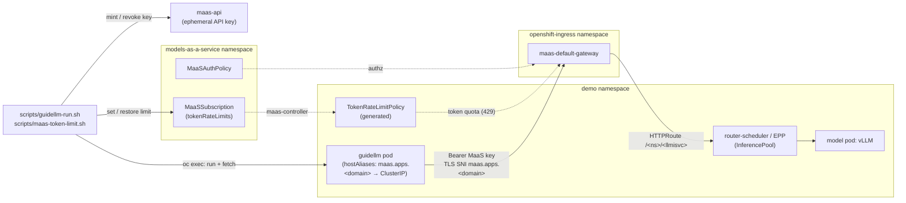

# Benchmark through the MaaS gateway with GuideLLM

**Last updated:** 2026-11-04 · **Based on:** OpenShift 4.22.18, RHOAI 3.5.2
(MaaS, Kuadrant `TokenRateLimitPolicy`), GuideLLM 0.7.1.

**Prerequisites:** the model has a `MaaSModelRef` and a `MaaSSubscription`; for
the comparison, a direct run from [guidellm-vllm-benchmark](../guidellm-vllm-benchmark/SKILL.md).
Scripts: [`guidellm-deploy.sh`](../../scripts/guidellm-deploy.sh),
[`guidellm-run.sh`](../../scripts/guidellm-run.sh),
[`guidellm-summary.sh`](../../scripts/guidellm-summary.sh),
[`maas-token-limit.sh`](../../scripts/maas-token-limit.sh) (`-h` for help).
Ready-to-run example for `qwen3-8b-fp8-maas`: [`examples/guidellm-maas/`](../../examples/guidellm-maas/)
(`deploy-guidellm.sh`, then `run-maas-benchmark.sh`).

## Architecture



## 1. Deploy GuideLLM with the gateway host alias

```bash
export NAMESPACE=demo LLMISVC=qwen3-8b-fp8-maas
MAAS_HOST=$(oc get gateway maas-default-gateway -n openshift-ingress \
  -o jsonpath='{.spec.listeners[?(@.protocol=="HTTPS")].hostname}')
GATEWAY_IP=$(oc get svc maas-default-gateway-openshift-gateway-controller -n openshift-ingress \
  -o jsonpath='{.spec.clusterIP}')

scripts/guidellm-deploy.sh --host-alias "$MAAS_HOST=$GATEWAY_IP"   # see guidellm-deploy
```

## 2. Size the run against the token quota

MaaS meters input plus output tokens per subscription and user. The default
run needs `MAX_REQUESTS × (PROMPT_TOKENS + OUTPUT_TOKENS)` = 100 × 1536 = 153,600
tokens; with 10% headroom, a 100,000-token quota fits about 58 requests.
Check the limits with `scripts/maas-token-limit.sh show`, then either:
- **shrink the run** with `MAX_REQUESTS` (preferred: touches nothing shared), or
- **raise the limit** for a full baseline, as in step 3. It applies to **every**
  user of the subscription until restored ([maas-token-rate-limit](../maas-token-rate-limit/SKILL.md)).

## 3. Run with an ephemeral key

The block runs in a subshell, so its `trap` revokes the key and restores the
limit even on failure, and `exit` doesn't close your terminal. The key lives only
in memory and the pod's 0600 scenario file; GuideLLM masks it in its JSON.

```bash
(
  set -euo pipefail
  export SUB=qwen3-8b-fp8-maas-premium MODEL_NS=$NAMESPACE MODEL=$LLMISVC
  MAAS_API=https://$MAAS_HOST/maas-api
  cleanup() {
    [ -z "${API_KEY_ID:-}" ] || curl -sk -o /dev/null -X DELETE "$MAAS_API/v1/api-keys/$API_KEY_ID" \
      -H "Authorization: Bearer $(oc whoami -t)"
    scripts/maas-token-limit.sh restore   # no-op if the limit was not raised
  }
  trap cleanup EXIT

  scripts/maas-token-limit.sh set 200000   # omit if the run fits the quota

  KEY_RESPONSE=$(curl -sk --fail-with-body -X POST "$MAAS_API/v1/api-keys" \
    -H "Authorization: Bearer $(oc whoami -t)" -H 'Content-Type: application/json' \
    -d "$(jq -n --arg sub "$SUB" '{ephemeral: true, expiresIn: "1h", name: "guidellm-gateway-benchmark", subscription: $sub}')")
  API_KEY_ID=$(jq -er .id <<<"$KEY_RESPONSE")
  MAAS_KEY=$(jq -er .key <<<"$KEY_RESPONSE")

  API_KEY=$MAAS_KEY SEED=102 scripts/guidellm-run.sh gateway https://$MAAS_HOST/$NAMESPACE/$LLMISVC publishers/$NAMESPACE/models/$LLMISVC
)
scripts/guidellm-summary.sh results/direct.json results/gateway.json
```

The gateway accepts the model as `publishers/<ns>/models/<llmisvc>`.

## Reference results

2026-11-04, 1x NVIDIA L40S (`g6e.4xlarge`), Qwen3-8B-FP8-dynamic. Throughput
profile at concurrency 8, 100 requests of 768/768 tokens, fresh prompts with
distinct seeds, runs back to back, quota raised to 200,000 for the gateway run:

| run | ok | err | req/s | out tok/s | TTFT p50 ms | TTFT p95 ms | ITL p50 ms | latency p50 s |
|---|---|---|---|---|---|---|---|---|
| direct (seed 101) | 100 | 0 | 0.58 | 447 | 261 | 361 | 16.9 | 13.3 |
| gateway (seed 102) | 100 | 0 | 0.58 | 447 | 255 | 397 | 16.9 | 13.3 |

The gateway path (auth, EPP, rate limiting) adds no measurable cost at the
median. TTFT p95 is ~36 ms higher, within run-to-run noise for 100 requests.
Decode dominates (ITL ~17 ms) on both paths.

## Gotchas

1. **The gateway's in-cluster Service name fails TLS** (curl exit 35): the
   listener only matches SNI `maas.apps.<domain>`, which resolves to the external
   load balancer. The host alias fixes it. Check with
   `curl -sk --resolve $MAAS_HOST:443:$GATEWAY_IP https://$MAAS_HOST/...`.
2. **429s mid-run mean the quota ran out.** At ~1,544 tokens per request, a
   100,000-token quota ran out after 66 requests and the other 34 got 429.
   `guidellm-run.sh` fails on any errored request.
3. **Don't borrow an application's key.** The quota counter is per subscription
   and user, so a benchmark on an app's key can push that app into 429s until
   the window rolls over. Always mint an ephemeral key.
4. **Use distinct seeds and run one after another.** A reused seed hits vLLM's
   prefix cache and makes TTFT look ~3x better; concurrent runs share the GPU.

## Cleanup

Step 3 revokes the key and restores the limit. To remove the alias:
`oc patch deploy/guidellm -n $NAMESPACE --type=json -p '[{"op":"remove","path":"/spec/template/spec/hostAliases"}]'`,
or [delete the pod](../guidellm-deploy/SKILL.md#cleanup).
