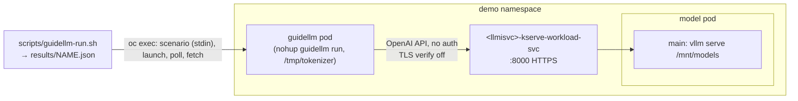

# Benchmark raw vLLM with GuideLLM

**Last updated:** 2026-11-04 · **Based on:** OpenShift 4.22.18, RHOAI 3.5.2,
`registry.redhat.io/rhaii/vllm-cuda-rhel9`, GuideLLM 0.7.1.

**Prerequisites:** a Ready `LLMInferenceService` (e.g. `qwen3-8b-fp8-maas`) and the
GuideLLM pod from [guidellm-deploy](../guidellm-deploy/SKILL.md).
Scripts: [`scripts/guidellm-run.sh`](../../scripts/guidellm-run.sh),
[`scripts/guidellm-summary.sh`](../../scripts/guidellm-summary.sh) (`-h` for help).

## Architecture



This path skips auth, EPP routing and quotas, so it measures the model server
alone. For what MaaS clients see, use
[guidellm-maas-gateway-benchmark](../guidellm-maas-gateway-benchmark/SKILL.md).

## Run

```bash
export NAMESPACE=demo LLMISVC=qwen3-8b-fp8-maas
DIRECT=https://$LLMISVC-kserve-workload-svc.$NAMESPACE.svc.cluster.local:8000

# Served model names: qwen3-8b-fp8-maas and publishers/demo/models/qwen3-8b-fp8-maas
oc get llminferenceservice $LLMISVC -n $NAMESPACE -o json | jq -r '[.status.addresses[].models[]?.name] | unique[]'

SEED=101 scripts/guidellm-run.sh direct $DIRECT $LLMISVC   # -> results/direct.{json,log,version}
```

The default workload is a throughput profile at concurrency 8 with 100 requests
of 768 prompt / 768 output tokens. Tune it with `CONC`, `MAX_REQUESTS`,
`PROMPT_TOKENS` and `OUTPUT_TOKENS`, or replace a whole spec with `PROFILE`,
`CONSTRAINT` or `DATA`. A concurrency sweep, for example:

```bash
SEED=103 PROFILE=kind=concurrent OVERRIDE='profile.streams 1,2,4,8,16' \
  scripts/guidellm-run.sh direct-sweep $DIRECT $LLMISVC   # one summary row per stream count
```

`guidellm-run.sh` fails if any request errored. The equivalent raw command in the pod:

```bash
guidellm run --backend kind=openai_http,target=$DIRECT,model=$LLMISVC \
  --tokenizer kind=hf_auto,model=/tmp/tokenizer \
  --profile kind=throughput,max_concurrency=8 \
  --constraint kind=max_requests,count=100 \
  --data kind=synthetic_text,prompt_tokens=768,output_tokens=768 \
  --seed kind=static,value=101 \
  --output kind=json,path=/tmp/direct.json --output kind=console
```

## Reference results

2026-11-04, 1x NVIDIA L40S (`g6e.4xlarge`), Qwen3-8B-FP8-dynamic with
`--max-model-len 32768`, default workload, fresh prompts (seed 101):

| run | ok | err | req/s | out tok/s | total tok/s | TTFT p50 ms | TTFT p95 ms | ITL p50 ms | latency p50 s |
|---|---|---|---|---|---|---|---|---|---|
| direct | 100 | 0 | 0.58 | 447 | 900 | 261 | 361 | 16.9 | 13.3 |

Decode is the bottleneck: ITL holds at ~17 ms, about 59 tok/s per stream or
450 output tok/s across 8 streams.

## Gotchas

1. **GuideLLM 0.7 options are `kind=...,key=value` specs.**
   - `--constraint kind=max_requests,count=N`; `max_requests=N` fails.
   - `--tokenizer kind=hf_auto,model=<path>` replaces `--processor`.
   - `--seed kind=static,value=N`.
   - `--backend kind=openai_http,target=...,model=...` also takes `api_key=` and `verify=` (default `false`).
   - `--scenario FILE` takes `{"spec": {...}}`; CLI options override it.
2. **vLLM serves HTTPS on 8000, not HTTP.** The KServe serving cert is accepted
   because GuideLLM defaults to `verify=false`.
3. **Prefix caching skews back-to-back runs.** Synthetic prompts are
   deterministic per seed (default 42). Reusing a seed hits vLLM's prefix cache
   and cuts TTFT about 3x (275 → 90 ms) while ITL is unchanged. Use a new seed
   per run (or restart the model pod), and run comparisons one after another.
