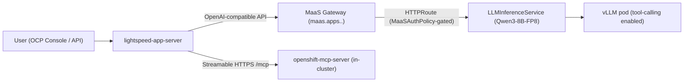

# Switch Lightspeed from an External LLM to MaaS Qwen

**Created:** 2026-11-02 · **Last updated:** 2026-11-02

**Based on:** OpenShift 4.22, `lightspeed-operator` v2.0.0, `rhods-operator` 3.5.2
(RHOAI 3.5), KServe `LLMInferenceService` v1alpha2 (llm-d), vLLM 0.24
(`registry.redhat.io/rhaii/vllm-cuda-rhel9:3.4.0`).

**Prerequisites:** Lightspeed already installed and working (see
[.cursor/skills/openshift-lightspeed-deepseek/SKILL.md](../../.cursor/skills/openshift-lightspeed-deepseek/SKILL.md)
for the base install). MaaS infra (`models-as-a-service`,
`redhat-ai-gateway-infra` namespaces, `maas-default-gateway`) already set up
by the RHOAI installer.

## Correction to an earlier skill

[misc/rhoai-isvc-maas-qwen/SKILL.md](../rhoai-isvc-maas-qwen/SKILL.md)
documents publishing a plain KServe `InferenceService` to MaaS via
`MaaSModelRef.spec.modelRef.kind: InferenceService`. **This does not work on
RHOAI 3.5** -- the actual `MaaSModelRef` CRD only accepts
`kind: LLMInferenceService` or `kind: ExternalModel`:

```bash
oc explain maasmodelref.spec.modelRef
#   kind	<string> -required-
#   enum: LLMInferenceService, ExternalModel
```

Confirmed empirically: applying a `MaaSModelRef` with `kind: InferenceService`
is rejected by the API server. Use the llm-d (`LLMInferenceService`) path
below instead -- it's also what this repo's own
`third_party/openshift-ai-bootstrap/yaml/infra/llmisvc-maas.yaml.tmpl` /
`make deploy-qwen3-8b-maas` already assume as the working default.

## Architecture



Versus the external-API flow, the model now runs on cluster GPUs instead of
calling out to a third-party API -- same `OLSConfig`/`type: openai` provider
shape, different URL/model/credentials.

## Step 1: Deploy Qwen3-8B-FP8 via MaaS (llm-d path)

Find your cluster's KServe config version prefix (varies by `rhods-operator`
version -- do not assume `v3-5-0`):

```bash
oc get llminferenceserviceconfig -n redhat-ods-applications | grep single-node-template-nvidia-cuda
```

Find your actual `HardwareProfile` name (don't assume `nvidia-gpu`):

```bash
oc get hardwareprofile -n redhat-ods-applications
```

Apply (adjust `baseRefs`/hardware-profile-name to match your cluster):

```yaml
apiVersion: serving.kserve.io/v1alpha1
kind: LLMInferenceService
metadata:
  name: qwen3-8b-fp8-maas
  namespace: demo
  annotations:
    opendatahub.io/hardware-profile-name: <your-gpu-hardware-profile>
    opendatahub.io/hardware-profile-namespace: redhat-ods-applications
    security.opendatahub.io/enable-auth: "true"
  labels:
    opendatahub.io/dashboard: "true"
    opendatahub.io/genai-asset: "true"
spec:
  model:
    name: qwen3-8b-fp8-maas
    uri: oci://registry.redhat.io/rhelai1/modelcar-qwen3-8b-fp8-dynamic:latest
  replicas: 1
  baseRefs:
    - name: <your-version-prefix>-kserve-config-llm-single-node-template-nvidia-cuda
  router:
    route: {}
    gateway:
      refs:
        - name: maas-default-gateway
          namespace: openshift-ingress
    scheduler: {}
  template:
    containers:
      - name: main
        env:
          - name: VLLM_ADDITIONAL_ARGS
            # See "vLLM flags that matter" below -- all three are required.
            value: "--enable-force-include-usage --max-model-len 32768 --enable-auto-tool-choice --tool-call-parser hermes"
        resources:
          limits: {cpu: "4", memory: 24Gi, nvidia.com/gpu: "1"}
          requests: {cpu: "2", memory: 16Gi, nvidia.com/gpu: "1"}
---
apiVersion: maas.opendatahub.io/v1alpha1
kind: MaaSModelRef
metadata:
  name: qwen3-8b-fp8-maas
  namespace: demo
spec:
  modelRef:
    kind: LLMInferenceService
    name: qwen3-8b-fp8-maas
```

Then the usual `MaaSAuthPolicy` + `MaaSSubscription` in `models-as-a-service`
(see [misc/rhoai-isvc-maas-qwen/SKILL.md](../rhoai-isvc-maas-qwen/SKILL.md)
for the full YAML -- that part of the older skill is correct).

### Gotcha: Gateway rejects routes from an unlabeled namespace

`maas-default-gateway`'s listener restricts `allowedRoutes` to namespaces
carrying a specific label:

```bash
oc get gateway maas-default-gateway -n openshift-ingress \
  -o jsonpath='{.spec.listeners[0].allowedRoutes.namespaces.selector}'
# {"matchLabels":{"maas.opendatahub.io/gateway-access":"true"}}
```

Without this label, `LLMInferenceService.status` shows
`HTTPRoutesReady=False` with `NotAllowedByListeners`. Fix:

```bash
oc label namespace demo maas.opendatahub.io/gateway-access=true
```

### Gotcha: `models-as-a-service` namespaces get auto-labeled, workload namespaces don't

Only namespaces created by the MaaS tenant controller (e.g.
`models-as-a-service` itself) get this label automatically. Any namespace you
deploy a model *into* (`demo`, or whatever you pick) needs it added manually.

## Step 2: Mint a MaaS API key

There's no `MaaSApiKey` CRD -- keys are minted via the MaaS API's own REST
endpoint, authenticated with the caller's own OpenShift bearer token (the
subscription's `owner.groups` must include a group the caller belongs to,
e.g. `system:authenticated`):

```bash
MAAS_DOMAIN=$(oc get gateway maas-default-gateway -n openshift-ingress \
  -o jsonpath='{.spec.listeners[0].hostname}')
TOKEN=<your-own-oc-bearer-token>   # oc create token <sa> if you don't have one handy

curl -sk -X POST "https://$MAAS_DOMAIN/v1/api-keys" \
  -H "Authorization: Bearer $TOKEN" -H "Content-Type: application/json" \
  -d '{"name":"<key-name>","subscription_id_header":"qwen3-8b-fp8-maas-premium"}'
# {"key":"sk-oai-...","id":"...","expiresAt":"...","ephemeral":false}
```

`name` is required -- omitting it returns
`{"error":"name is required for non-ephemeral keys"}`. The `key` is returned
once; save it immediately.

**Find the correct model name for API calls** -- it is *not* the short
`metadata.name` you used, but the MaaS-assigned publisher path:

```bash
curl -sk "https://$MAAS_DOMAIN/v1/models" -H "Authorization: Bearer <maas-api-key>"
# "id":"publishers/<namespace>/models/<name>"  <-- use this full string as "model" in requests
```

## Step 3: Point Lightspeed at it

```bash
oc delete secret credentials -n openshift-lightspeed --ignore-not-found
oc create secret generic credentials -n openshift-lightspeed \
  --from-literal=apitoken=<maas-api-key>
```

```yaml
apiVersion: ols.openshift.io/v1alpha1
kind: OLSConfig
metadata:
  name: cluster
spec:
  llm:
    providers:
      - name: maas-qwen
        type: openai
        url: "https://<maas-gateway-hostname>/v1"
        credentialsSecretRef:
          name: credentials
        models:
          - name: publishers/<namespace>/models/<name>
  ols:
    defaultProvider: maas-qwen
    defaultModel: publishers/<namespace>/models/<name>
    logLevel: INFO
    deployment:
      replicas: 1
```

```bash
oc delete pod -n openshift-lightspeed -l app.kubernetes.io/name=lightspeed-service-api
```

Confirm readiness the same way as the DeepSeek install: wait for `2/2 Ready`
and `LLM connection checked - LLM is ready` in the logs
(`oc logs ... | grep "LLM connection"`).

## vLLM flags that matter for Lightspeed + MCP

Lightspeed's agentic/MCP flow puts real demands on the serving model that a
simple chat query doesn't. Get these three flags wrong and Lightspeed either
won't start or will silently fail to use MCP tools:

| Flag | Why | Symptom if missing/wrong |
|---|---|---|
| `--max-model-len <big enough>` | MCP tool *definitions* alone cost ~2-4K input tokens before the user's question is even added; Lightspeed also requests up to 4096 output tokens by default | Readiness probe loop: `max_output_tokens=4096 cannot be greater than max_model_len=...` (too small), or `400 ... total of at least 8193 tokens` (close but still short). Use 32768 for headroom; 2048/8192 are both too small for a tool-enabled single query. |
| `--enable-auto-tool-choice` | Without it vLLM never activates tool-call parsing at all | Model's tool-call JSON leaks into the plain-text `response` field as literal `<tool_call>{...}</tool_call>`; `tool_calls`/`tool_results` in Lightspeed's API response stay empty even though the model "tried" |
| `--tool-call-parser hermes` | Qwen3 (non-coder variants) emits `<tool_call>{json}</tool_call>` blocks matching the Hermes/ChatML convention; vLLM needs to know which parser to apply | Same symptom as above. Check `--tool-call-parser` enum values for your vLLM build (`python -m vllm.entrypoints.openai.api_server --help`) if using a different model family -- it varies (`qwen3_xml`/`qwen3_coder` exist for other Qwen3 variants). |

Verify by checking the `/v1/query` response has non-empty `tool_calls` with
`status: "success"` in `tool_results`, not just prose mentioning tool names.

## Known limitation: Qwen3-8B is small and chatty

Qwen3-8B-FP8 defaults to its `<think>...</think>` reasoning mode, which:
- Roughly doubles or triples output tokens vs. a non-reasoning model for the
  same answer (a 3-word greeting burned ~580 completion tokens in testing).
- Sometimes emits **two** `<think>` blocks per turn when a tool call is
  involved -- one deciding to call the tool, one processing the result.
- Is noticeably slower end-to-end than DeepSeek-chat for the same query on
  this hardware (single L40S 48GB).

It does correctly decide when to call MCP tools and parses/synthesizes
results correctly for straightforward single-tool queries (verified: listing
non-Running pods in a namespace). Not verified: complex multi-tool chains
(e.g. `pods_list` -> `pods_log` in sequence) -- test before relying on this
for deep multi-step cluster debugging.

## Switching back to DeepSeek (or any other provider)

Reverse Steps 2-3: recreate the `credentials` Secret with the DeepSeek key,
re-apply the original `OLSConfig` (see
[.cursor/skills/openshift-lightspeed-deepseek/SKILL.md](../../.cursor/skills/openshift-lightspeed-deepseek/SKILL.md)),
restart `lightspeed-app-server`. The MaaS Qwen deployment can stay running
independently -- it's not coupled to Lightspeed's config.
