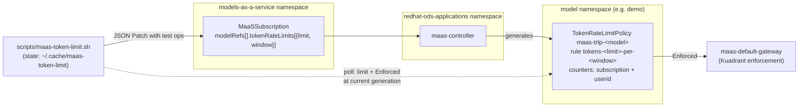

# Change a MaaS token rate limit

**Last updated:** 2026-11-04 · **Based on:** RHOAI 3.5.2 MaaS (`maas-controller`), Kuadrant.

Script: [`scripts/maas-token-limit.sh`](../../scripts/maas-token-limit.sh) (`-h` for help; needs `oc`, `jq`).

## Architecture



- **The limit is shared by every user of the subscription**, though each user
  has their own counter. A raised limit applies to everyone until you restore it.
- MaaS counts input plus output tokens. Running out returns HTTP 429 for the
  rest of the window.
- Edit the subscription, never the policy: the controller owns the policy and
  reverts manual changes.

## Usage

```bash
scripts/maas-token-limit.sh show   # subscription limits + policy rules with Enforced status

export SUB=qwen3-8b-fp8-maas-premium MODEL_NS=demo MODEL=qwen3-8b-fp8-maas   # WINDOW defaults to 1h
trap 'scripts/maas-token-limit.sh restore' EXIT   # restores even if the workload fails
scripts/maas-token-limit.sh set 200000            # -> "✅ Enforced: 200000/1h"
# ... run the workload ...
scripts/maas-token-limit.sh restore; trap - EXIT  # -> "✅ Enforced: 100000/1h"
```

`set` works both ways, so you can also lower a limit to test 429 handling. The script:
- Requires exactly one matching model and window.
- Saves the original limit to `~/.cache/maas-token-limit/` before patching, and
  refuses to `set` again until you `restore`. `restore` also works from a new shell.
- Patches with JSON Patch `test` ops, so it fails rather than overwrite someone
  else's change.
- Waits (up to 5 min) until the policy enforces the new value for its current generation.

## Troubleshooting

- **Times out waiting for enforcement.** Check `oc get tokenratelimitpolicy -n $MODEL_NS -o yaml`
  and the `maas-controller` logs in `redhat-ods-applications`. The rule key embeds
  the limit and changes on every update, so the script finds the rule by its predicate
  `"<sub-ns>/<sub>@<model-ns>/<model>"` instead.
- **"Limit was changed ... by someone else".** Reconcile by hand using the
  original in the state file, then delete the file.
- **429s persist after raising.** The current window's counter keeps the tokens
  already spent.
- **Manual change:** `oc patch maassubscription $SUB -n models-as-a-service --type=json -p
  '[{"op":"replace","path":"/spec/modelRefs/<i>/tokenRateLimits/<j>/limit","value":<new>}]'`.
