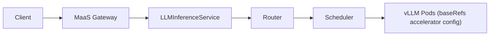
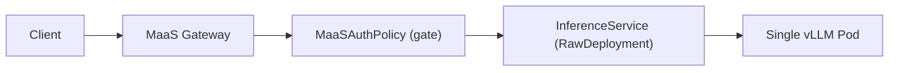
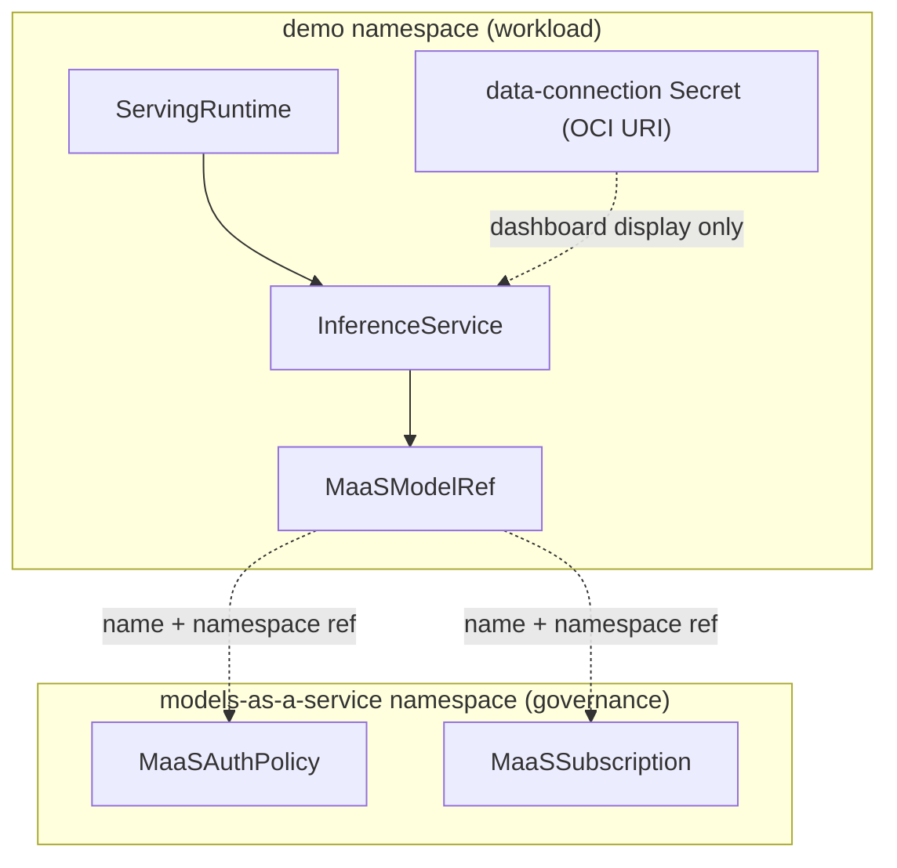

# InferenceService + MaaS, No llm-d

**Created:** 2026-11-02 · **Last updated:** 2026-11-02

**Based on:** RHOAI 3.5, KServe RawDeployment mode. Concrete example model:
`Qwen/Qwen3-8B-FP8-dynamic` served from the Red Hat OCI modelcar
`registry.redhat.io/rhelai1/modelcar-qwen3-8b-fp8-dynamic:latest`.

**Not independently verified:** the YAML below mirrors templates that were
rendered and checked for correctness locally (`yq`/`envsubst`), but this
flow has not been applied end-to-end against a live cluster. In particular,
the MaaS-gateway auto-routing to a plain `InferenceService` (no explicit
`router.gateway.refs` the way llm-d uses) is architecturally reasonable but
should be confirmed on your own cluster.

## llm-d vs plain InferenceService for MaaS

MaaS governance (auth + subscriptions) does not require llm-d. RHOAI's MaaS
layer only needs a `MaaSModelRef` pointing at *some* serving object --
`spec.modelRef.kind` can be `LLMInferenceService` **or** `InferenceService`.

| Aspect | llm-d (`LLMInferenceService`) | Plain `InferenceService` (this skill) |
|---|---|---|
| Router / scheduler | Yes -- prefix-cache aware routing, disaggregated prefill/decode | None -- direct RawDeployment |
| `baseRefs` | Yes (accelerator/platform config) | Not applicable |
| Components deployed | Router, scheduler, workload pods | Just the model pod |
| Best for | Production, multi-replica, high-throughput serving | Testing, small models, simple single-pod serving |
| MaaS gateway integration | Built into `router.gateway.refs` | Via `security.opendatahub.io/enable-auth: "true"` annotation + `MaaSAuthPolicy` |

Use plain `InferenceService` when you want MaaS's auth/rate-limit/API-key
mechanics for a small or test model without the operational overhead of
llm-d's router/scheduler.

## Architecture

**llm-d path** (existing, not used here):



**Plain InferenceService path** (this skill):



**Resource relationships across namespaces:**



## MaaS registration deep-dive

MaaS governance is built from three CRDs under `maas.opendatahub.io/v1alpha1`.
All three must exist for a model to be callable through the MaaS gateway.

### MaaSModelRef -- publishes the model

Lives in the **same namespace as the model** (e.g. `demo`). It's the bridge
between the serving layer and MaaS: without it, MaaS has no awareness the
model exists at all.

```yaml
spec:
  modelRef:
    kind: InferenceService   # or LLMInferenceService for the llm-d path
    name: qwen3-8b-fp8-maas
```

`spec.modelRef.kind` is the field that makes the non-llm-d path work -- it's
the only difference from the llm-d `MaaSModelRef`.

### MaaSAuthPolicy -- gates access

Lives in `models-as-a-service`. Controls *who* can call the model through
the MaaS gateway, referencing the model by `name` + `namespace`:

```yaml
spec:
  modelRefs:
    - name: qwen3-8b-fp8-maas
      namespace: demo          # the model's namespace, not models-as-a-service
  subjects:
    groups:
      - name: system:authenticated   # or a specific group for per-team access
    users: []
```

Multiple `MaaSAuthPolicy` objects can reference the same model for layered
access control (e.g. one for `system:authenticated`, another for a specific
group with different terms).

### MaaSSubscription -- meters usage

Lives in `models-as-a-service`. Defines token-based rate limits and
scheduling priority, and is what the MaaS API key is minted against:

```yaml
spec:
  owner:
    groups:
      - name: system:authenticated
    users: []
  modelRefs:
    - name: qwen3-8b-fp8-maas
      namespace: demo
      tokenRateLimits:
        - limit: 100000       # tokens
          window: 1h
  priority: 99                # lower number = higher priority when subscriptions compete
```

### How they work together

```
MaaSModelRef  --publishes-->  MaaSAuthPolicy  --gates-->  MaaSSubscription  --meters-->  API key
```

1. **MaaSModelRef** makes the model visible to MaaS.
2. **MaaSAuthPolicy** decides who is allowed to call it.
3. **MaaSSubscription** decides how much they can call it, at what priority,
   and is the object a consumer's MaaS API key is tied to.

### Namespace topology

- Model + `MaaSModelRef` -> workload namespace (`demo` in this example)
- `MaaSAuthPolicy` + `MaaSSubscription` -> always `models-as-a-service`
- They cross-reference purely by `name` + `namespace` strings -- there's no
  ownerRef/label coupling, so typos in either field silently produce an
  unreachable model (no error, just 404/403 at the gateway).

## Example YAML: Qwen3-8B-FP8-dynamic via InferenceService + MaaS

All 6 resources, annotated. Apply with `oc apply -f <file>` (order matters:
ServingRuntime/Secret before InferenceService; InferenceService before
MaaSModelRef; MaaSModelRef before MaaSAuthPolicy/MaaSSubscription -- though
in practice `oc apply` on all of them together also reconciles fine once the
controllers retry).

```yaml
# 1. ServingRuntime -- the vLLM engine, reusable across models.
#    The /dev/shm volume matters: vLLM uses shared memory for tensor
#    operations and can crash under load without it.
apiVersion: serving.kserve.io/v1alpha1
kind: ServingRuntime
metadata:
  name: qwen3-8b-fp8-maas
  namespace: demo
  labels:
    opendatahub.io/dashboard: "true"
spec:
  containers:
    - name: kserve-container
      image: registry.redhat.io/rhaii/vllm-cuda-rhel9:3.4.0
      command: [python, -m, vllm.entrypoints.openai.api_server]
      args:
        - --port=8080
        - --model=/mnt/models
        - --served-model-name={{.Name}}
      env:
        - name: HF_HOME
          value: /tmp/hf_home
      ports:
        - containerPort: 8080
          protocol: TCP
      volumeMounts:
        - mountPath: /dev/shm
          name: shm
  volumes:
    - emptyDir:
        medium: Memory
        sizeLimit: 2Gi
      name: shm
  supportedModelFormats:
    - name: vLLM
      autoSelect: true
---
# 2. Data-connection Secret -- optional. Only used by the RHOAI dashboard
#    to display the model's source URI in its UI; the InferenceService
#    below sets storageUri directly, so this isn't required to actually
#    serve the model. URI value is base64 of the oci:// string below.
apiVersion: v1
kind: Secret
metadata:
  name: qwen3-8b-fp8-maas
  namespace: demo
  annotations:
    opendatahub.io/connection-type-ref: uri-v1
    openshift.io/display-name: qwen3-8b-fp8-maas
  labels:
    opendatahub.io/dashboard: "true"
type: Opaque
data:
  # echo -n "oci://registry.redhat.io/rhelai1/modelcar-qwen3-8b-fp8-dynamic:latest" | base64
  URI: b2NpOi8vcmVnaXN0cnkucmVkaGF0LmlvL3JoZWxhaTEvbW9kZWxjYXItcXdlbjMtOGItZnA4LWR5bmFtaWM6bGF0ZXN0
---
# 3. InferenceService -- the deployed model. NOT LLMInferenceService.
#    security.opendatahub.io/enable-auth: "true" is what lets the MaaS
#    gateway's auth policy actually gate requests to this isvc.
#    hardware-profile-name/namespace drive RHOAI's mutating webhook that
#    injects GPU tolerations/nodeSelectors -- required on clusters that use
#    hardware profiles (RHOAI 3.x default); drop if yours doesn't.
apiVersion: serving.kserve.io/v1beta1
kind: InferenceService
metadata:
  name: qwen3-8b-fp8-maas
  namespace: demo
  annotations:
    serving.kserve.io/deploymentMode: RawDeployment
    security.opendatahub.io/enable-auth: "true"
    opendatahub.io/hardware-profile-name: nvidia-gpu
    opendatahub.io/hardware-profile-namespace: redhat-ods-applications
  labels:
    networking.kserve.io/visibility: exposed
    opendatahub.io/dashboard: "true"
    opendatahub.io/genai-asset: "true"
spec:
  predictor:
    minReplicas: 1
    maxReplicas: 1
    model:
      modelFormat:
        name: vLLM
      runtime: qwen3-8b-fp8-maas
      storageUri: "oci://registry.redhat.io/rhelai1/modelcar-qwen3-8b-fp8-dynamic:latest"
      args:
        - --max-model-len
        - "2048"
      resources:
        limits:
          cpu: "2"
          memory: 24Gi
          nvidia.com/gpu: "1"
        requests:
          cpu: "2"
          memory: 4Gi
          nvidia.com/gpu: "1"
---
# 4. MaaSModelRef -- publishes the InferenceService to MaaS.
#    This is the piece that differs from the llm-d path (kind: InferenceService).
apiVersion: maas.opendatahub.io/v1alpha1
kind: MaaSModelRef
metadata:
  name: qwen3-8b-fp8-maas
  namespace: demo
  annotations:
    openshift.io/display-name: qwen3-8b-fp8-maas
spec:
  modelRef:
    kind: InferenceService
    name: qwen3-8b-fp8-maas
---
# 5. MaaSAuthPolicy -- who can call it, lives in models-as-a-service.
apiVersion: maas.opendatahub.io/v1alpha1
kind: MaaSAuthPolicy
metadata:
  name: qwen3-8b-fp8-maas-access
  namespace: models-as-a-service
spec:
  modelRefs:
    - name: qwen3-8b-fp8-maas
      namespace: demo
  subjects:
    groups:
      - name: system:authenticated
    users: []
---
# 6. MaaSSubscription -- rate limits + priority, lives in models-as-a-service.
apiVersion: maas.opendatahub.io/v1alpha1
kind: MaaSSubscription
metadata:
  name: qwen3-8b-fp8-maas-premium
  namespace: models-as-a-service
spec:
  owner:
    groups:
      - name: system:authenticated
    users: []
  modelRefs:
    - name: qwen3-8b-fp8-maas
      namespace: demo
      tokenRateLimits:
        - limit: 100000
          window: 1h
  priority: 99
```

## Verification

Checks for both model serving health and MaaS registration:

```bash
# 1. InferenceService readiness
oc get isvc qwen3-8b-fp8-maas -n demo

# 2. Pod running
oc get pods -n demo -l serving.kserve.io/inferenceservice=qwen3-8b-fp8-maas

# 3. vLLM is actually serving (curl from inside the pod)
POD=$(oc get pods -n demo -l serving.kserve.io/inferenceservice=qwen3-8b-fp8-maas \
  --field-selector=status.phase=Running -o jsonpath='{.items[0].metadata.name}')
oc exec -n demo "$POD" -c kserve-container -- curl -sf http://localhost:8080/v1/models

# 4. MaaS registration objects exist
oc get maasmodelref qwen3-8b-fp8-maas -n demo
oc get maasauthpolicy qwen3-8b-fp8-maas-access -n models-as-a-service
oc get maassubscription qwen3-8b-fp8-maas-premium -n models-as-a-service

# 5. MaaS gateway reachability (401/403 without an API key is expected and
#    confirms the gateway route + auth enforcement are both live)
MAAS_DOMAIN=$(oc get gateway maas-default-gateway -n openshift-ingress \
  -o jsonpath='{.spec.listeners[0].hostname}')
curl -sk -o /dev/null -w "%{http_code}\n" "https://$MAAS_DOMAIN/v1/models"
```

A real end-to-end call needs a MaaS API key, generated per-`MaaSSubscription`
from the RHOAI dashboard (Settings > Subscriptions), then:

```bash
curl -sk "https://$MAAS_DOMAIN/v1/chat/completions" \
  -H "Authorization: Bearer <maas-api-key>" \
  -H "Content-Type: application/json" \
  -d '{"model":"qwen3-8b-fp8-maas","messages":[{"role":"user","content":"hi"}]}'
```

## Deploying

The six resources above are fully self-contained -- no templating tool
required. Save them as one multi-document YAML file and apply directly:

```bash
oc apply -f qwen3-8b-fp8-maas.yaml
```

To reuse this pattern for a different model, swap `storageUri` (or
`pvc://...` for PVC-backed storage) in the `InferenceService`, update the
Secret's base64 `URI` to match, and find/replace `qwen3-8b-fp8-maas`
consistently across all six resources (it's used as the `ServingRuntime`,
`Secret`, `InferenceService`, and `MaaSModelRef` name, and as the `name`
prefix for `MaaSAuthPolicy`/`MaaSSubscription`). If automating this across
many models, template the six resources with whatever tool your repo
already uses (`envsubst`, `yq`, Helm, Kustomize, etc.) -- there is nothing
MaaS- or InferenceService-specific about the templating mechanism itself.
