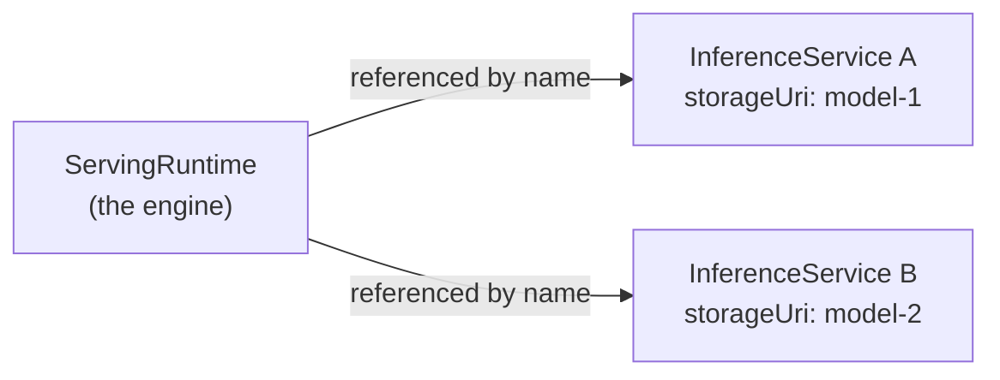

# MetaX GPU InferenceService on RHOAI

**Created:** 2026-11-02 · **Last updated:** 2026-11-02

**Verified against:** RHOAI 3.5.2, KServe RawDeployment mode. The MetaX
device-plugin resource name (`metax-tech.com/gpu`), image references, and
vLLM `--device` flag below are **placeholders** based on the common
"`<vendor-domain>/gpu`" device-plugin convention GPU vendors use -- confirm
the actual values with the customer's MetaX device-plugin DaemonSet and
vLLM-MUSA image docs before applying (`oc describe node <metax-node> | grep
-i metax`, or `oc get daemonset -n <metax-namespace>`), since MetaX is
**not** an OOTB RHOAI component today (no `ServingRuntime` template, no
bundled image, no cluster-wide device-plugin operator shipped by Red Hat).

## Concepts: ServingRuntime vs InferenceService

KServe splits "how to run a model" from "which model to run" into two CRDs:



- **`ServingRuntime`** (`serving.kserve.io/v1alpha1`, namespaced): defines
  the inference *engine* -- container image, entrypoint/command, CLI args,
  ports, env vars, and which `supportedModelFormats` it can serve. It does
  **not** reference a specific model. One `ServingRuntime` is typically
  reused by many `InferenceService` objects in the same namespace (e.g. one
  `vllm-metax-runtime` can back several different MetaX-served models).
- **`InferenceService`** (`serving.kserve.io/v1beta1`, namespaced): the
  actual deployed model endpoint. References a `ServingRuntime` by name via
  `spec.predictor.model.runtime`, and adds the model-specific bits:
  `storageUri` (where the weights live -- `hf://`, `s3://`, `pvc://`,
  `oci://`), replica counts, GPU `resources`, and `tolerations` needed to
  land on the right node pool. KServe's controller reads both objects
  together and renders a `Deployment` + `Service` (RawDeployment mode) that
  mounts the downloaded model at `/mnt/models` into the runtime's container.
- **Why split them**: swapping a `ServingRuntime`'s image (e.g. a vLLM
  version bump) doesn't require touching every `InferenceService`, and
  pointing an `InferenceService` at a different model doesn't require a new
  runtime -- only a change to the underlying accelerator/driver stack
  requires a *different* `ServingRuntime`.

## What you need before deploying on MetaX

1. MetaX MUSA driver and Kubernetes device plugin already installed and
   healthy on the GPU nodes (there is no Red Hat-shipped operator for this
   -- it comes from MetaX).
2. A vLLM container image built against MetaX's MUSA runtime (customer- or
   vendor-supplied; confirm the correct `--device` flag, or whether one is
   needed at all, from that image's documentation).
3. The exact device-plugin resource name the customer's plugin registers
   (assumed `metax-tech.com/gpu` below -- verify with `oc describe node
   <metax-node>` under `Capacity`/`Allocatable`).
4. Whether MetaX GPU nodes carry a scheduling taint, and under what exact
   key (assumed `metax-tech.com/gpu:NoSchedule` below -- verify with `oc get
   nodes -o json | jq '.items[].spec.taints'`; if untainted, drop the
   `tolerations` block from the `InferenceService` example).

## Example: ServingRuntime for MetaX vLLM

```yaml
apiVersion: serving.kserve.io/v1alpha1
kind: ServingRuntime
metadata:
  name: vllm-metax-runtime
  labels:
    opendatahub.io/dashboard: "true"
  annotations:
    openshift.io/display-name: vLLM MetaX GPU ServingRuntime for KServe
    # Hints the RHOAI dashboard's hardware-profile picker at the right
    # accelerator type; purely informational, does not affect scheduling.
    opendatahub.io/recommended-accelerators: '["metax-tech.com/gpu"]'
spec:
  annotations:
    opendatahub.io/kserve-runtime: vllm
    prometheus.io/path: /metrics
    prometheus.io/port: "8080"
  multiModel: false
  supportedModelFormats:
    - name: vLLM
      autoSelect: true
  containers:
    - name: kserve-container
      # Customer/vendor-supplied image with vLLM built against MetaX's
      # MUSA runtime.
      image: <registry>/<repo>/vllm-musa:<tag>
      command:
        - python
        - -m
        - vllm.entrypoints.openai.api_server
      args:
        - --port=8080
        - --model=/mnt/models
        - --served-model-name={{.Name}}
        - --max-model-len=8192
        - --gpu-memory-utilization=0.85
        # Confirm this flag/value against the vendor's vLLM-MUSA fork docs;
        # omit entirely if the build auto-detects MUSA without a flag.
        - --device=musa
      env:
        - name: HF_HOME
          value: /tmp/hf_home
      ports:
        - containerPort: 8080
          protocol: TCP
      resources:
        requests:
          cpu: "2"
          memory: 8Gi
          metax-tech.com/gpu: "1"
        limits:
          cpu: "4"
          memory: 16Gi
          metax-tech.com/gpu: "1"
```

## Example: InferenceService using the MetaX runtime

```yaml
apiVersion: serving.kserve.io/v1beta1
kind: InferenceService
metadata:
  name: qwen-demo-llm-metax
  labels:
    opendatahub.io/dashboard: "true"
spec:
  predictor:
    minReplicas: 1
    maxReplicas: 1
    # Only needed if MetaX GPU nodes carry a matching NoSchedule taint
    # (common pattern to keep GPU nodes reserved for GPU workloads).
    # Confirm the actual taint key on the customer's cluster with:
    #   oc get nodes -o json | jq '.items[].spec.taints'
    tolerations:
      - key: metax-tech.com/gpu
        operator: Exists
        effect: NoSchedule
    model:
      modelFormat:
        name: vLLM
      runtime: vllm-metax-runtime
      # Pulls straight from Hugging Face at pod startup -- no S3/PVC
      # staging required. Swap for any small, ungated instruct model.
      storageUri: "hf://Qwen/Qwen2.5-1.5B-Instruct"
      resources:
        requests:
          cpu: "2"
          memory: 8Gi
          metax-tech.com/gpu: "1"
        limits:
          cpu: "4"
          memory: 16Gi
          metax-tech.com/gpu: "1"
```

Apply both with `oc apply -f <file>` in the target namespace (namespace and
`Route`/external-exposure setup are out of scope here -- see
`openshift/demo-inferenceservice/` in the `rhoai-voice-bot` repo for an
end-to-end flow including namespace, Route, and verification `curl`
commands against `/v1/models` and `/v1/chat/completions`).

## Open questions to confirm with the customer before deploying

1. **Device-plugin resource name**: is it really `metax-tech.com/gpu`, or
   does their device-plugin register under a different vendor domain/name?
   Check with `oc describe node <metax-node>` under `Capacity`/`Allocatable`.
2. **Node taint**: do MetaX GPU nodes carry a `NoSchedule` taint at all, and
   under what exact key? If untainted, remove the `tolerations` block
   entirely.
3. **vLLM-MUSA image**: does the customer already have a built image, or
   does it need to be built from a MetaX-provided Dockerfile/fork of vLLM?
   Confirm the correct `--device` flag (or whether it's unnecessary) from
   that image's documentation.
4. **MUSA driver install**: confirmed present and healthy on the node
   before troubleshooting `InferenceService` scheduling -- a `Pending` pod
   with `Insufficient metax-tech.com/gpu` means either the driver/device
   plugin isn't running or the resource name above is wrong.
