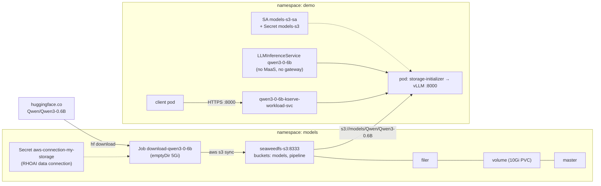

# SeaweedFS S3 + Qwen3-0.6B on OpenShift, served by an LLMInferenceService

**Verified on:** OpenShift on AWS (gp3-csi default StorageClass), RHOAI 3.5.2, SeaweedFS Helm chart
4.52.0, `registry.redhat.io/ubi9/python-312`, LLMInferenceService on 1 time-sliced NVIDIA L40S. Recipe taken from
`third_party/openshift-ai-bootstrap` (`make deploy-seaweedfs`, `yaml/infra/seaweedfs-values.yaml`,
`yaml/infra/data-connection-seaweedfs.yaml.tmpl`).

## Architecture



## 1. Prerequisites

- `oc` logged in as cluster-admin, `helm` 3, `envsubst`.
- A default StorageClass (`oc get sc`): SeaweedFS creates 3 PVCs (1Gi master, 1Gi filer, 10Gi volume).
  Raise `volume.dataDirs[0].size` for larger models.
- Egress to `seaweedfs.github.io`, `huggingface.co` and `pypi.org` (or mirrors).

## 2. Install SeaweedFS

Save as `seaweedfs-values.yaml`:

```yaml
fullnameOverride: seaweedfs

master:
  data: {type: persistentVolumeClaim, size: 1Gi}
  logs: {type: emptyDir}
  podSecurityContext: {enabled: true, runAsNonRoot: true}
  containerSecurityContext: &csc
    enabled: true
    allowPrivilegeEscalation: false
    capabilities: {drop: ["ALL"]}
    runAsNonRoot: true
    seccompProfile: {type: RuntimeDefault}

volume:
  dataDirs:
    - {name: data, type: persistentVolumeClaim, size: 10Gi, maxVolumes: 0}
  logs: {type: emptyDir}
  podSecurityContext: {enabled: true, runAsNonRoot: true}
  containerSecurityContext: *csc

filer:
  data: {type: persistentVolumeClaim, size: 1Gi}
  logs: {type: emptyDir}
  podSecurityContext: {enabled: true, runAsNonRoot: true}
  containerSecurityContext: *csc

s3:
  enabled: true
  enableAuth: true
  credentials:
    admin: {accessKey: admin, secretKey: admin}   # change for anything non-throwaway
  createBuckets:
    - name: models
    - name: pipeline
  logs: {type: emptyDir}
  podSecurityContext: {enabled: true, runAsNonRoot: true}
  containerSecurityContext: *csc

admin:
  enabled: true
  secret: {adminUser: admin, adminPassword: admin}
  logs: {type: emptyDir}
  podSecurityContext: {enabled: true, runAsNonRoot: true}
  containerSecurityContext: *csc
```

```bash
export NS=models
oc new-project $NS
helm repo add seaweedfs https://seaweedfs.github.io/seaweedfs/helm && helm repo update seaweedfs
helm install seaweedfs seaweedfs/seaweedfs -n $NS -f seaweedfs-values.yaml
oc rollout status deploy/seaweedfs-s3 -n $NS --timeout=300s
oc wait pod/seaweedfs-master-0 -n $NS --for=condition=Ready --timeout=180s
oc get pods,pvc -n $NS     # admin-0, filer-0, master-0, volume-0, s3-* all Running; 3 PVCs Bound
```

The chart writes the S3 keys to Secret `seaweedfs-s3-secret` (`admin_access_key_id`,
`admin_secret_access_key`) and creates the `models` and `pipeline` buckets.

## 3. RHOAI S3 data connection

Shows up in the dashboard under the project's Connections, and feeds the download Job.
Save as `data-connection.yaml.tmpl` (`${...}` are filled by `envsubst`):

```yaml
apiVersion: v1
kind: Secret
metadata:
  name: aws-connection-my-storage
  labels:
    opendatahub.io/dashboard: 'true'
    opendatahub.io/managed: 'true'
  annotations:
    opendatahub.io/connection-type: s3
    opendatahub.io/connection-type-ref: s3
stringData:
  AWS_ACCESS_KEY_ID: ${AWS_ACCESS_KEY_ID}
  AWS_SECRET_ACCESS_KEY: ${AWS_SECRET_ACCESS_KEY}
  AWS_DEFAULT_REGION: us-east-1
  AWS_S3_BUCKET: models
  AWS_S3_ENDPOINT: http://seaweedfs-s3.${NS}.svc.cluster.local:8333
  AWS_ENDPOINT_URL: http://seaweedfs-s3.${NS}.svc.cluster.local:8333
```

```bash
export AWS_ACCESS_KEY_ID=$(oc get secret seaweedfs-s3-secret -n $NS -o jsonpath='{.data.admin_access_key_id}' | base64 -d)
export AWS_SECRET_ACCESS_KEY=$(oc get secret seaweedfs-s3-secret -n $NS -o jsonpath='{.data.admin_secret_access_key}' | base64 -d)
envsubst < data-connection.yaml.tmpl | oc apply -n $NS -f -
```

`AWS_ENDPOINT_URL` is what makes the `aws` CLI in the Job talk to SeaweedFS without `--endpoint-url`.

## 4. Download the model into S3

Save as `download-qwen3-0-6b.yaml` (change `MODEL` for another repo; add an `HF_TOKEN` env for gated ones):

```yaml
apiVersion: batch/v1
kind: Job
metadata:
  name: download-qwen3-0-6b
spec:
  backoffLimit: 2
  template:
    spec:
      restartPolicy: Never
      containers:
        - name: download
          image: registry.redhat.io/ubi9/python-312
          command: [bash, -ec]
          args:
            - |
              pip install -q huggingface_hub awscli
              aws s3 ls s3://models >/dev/null 2>&1 || aws s3 mb s3://models
              hf download "$MODEL" --local-dir /work/m
              rm -rf /work/m/.cache
              aws s3 sync --only-show-errors /work/m "s3://models/$MODEL/"
              aws s3 ls --recursive --human-readable "s3://models/$MODEL/"
          env:
            - name: MODEL
              value: Qwen/Qwen3-0.6B
          envFrom:
            - secretRef:
                name: aws-connection-my-storage
          volumeMounts:
            - name: work
              mountPath: /work
      volumes:
        - name: work
          emptyDir:
            sizeLimit: 5Gi        # >= model size
```

```bash
oc apply -n $NS -f download-qwen3-0-6b.yaml
oc wait --for=condition=complete job/download-qwen3-0-6b -n $NS --timeout=15m
oc logs job/download-qwen3-0-6b -n $NS | tail -12
```

Takes about 2 minutes on AWS (pip install dominates; the 1.4 GiB download and sync are seconds).

## 5. Verify from a fresh pod

```bash
oc run s3check -n $NS --rm -i --restart=Never --image=registry.redhat.io/ubi9/python-312 \
  --overrides='{"spec":{"containers":[{"name":"s3check","image":"registry.redhat.io/ubi9/python-312",
  "command":["bash","-c","pip install -q awscli; aws s3 ls; aws s3 ls --recursive --human-readable --summarize s3://models/Qwen/Qwen3-0.6B/"],
  "envFrom":[{"secretRef":{"name":"aws-connection-my-storage"}}]}]}}'
```

Expected:

```
2026-11-07 14:57:15 models
2026-11-07 14:57:16 pipeline
... 726 Bytes Qwen/Qwen3-0.6B/config.json
... 239 Bytes Qwen/Qwen3-0.6B/generation_config.json
... 1.6 MiB   Qwen/Qwen3-0.6B/merges.txt
... 1.4 GiB   Qwen/Qwen3-0.6B/model.safetensors
... 10.9 MiB  Qwen/Qwen3-0.6B/tokenizer.json
... 9.5 KiB   Qwen/Qwen3-0.6B/tokenizer_config.json
... 2.6 MiB   Qwen/Qwen3-0.6B/vocab.json
(+ .gitattributes, LICENSE, README.md)
Total Objects: 10
   Total Size: 1.4 GiB
```

## 6. S3 credentials for KServe (Secret + ServiceAccount)

KServe's storage-initializer (the init container that copies `s3://...` into `/mnt/models`) reads
the S3 keys from Secrets listed on the pod's ServiceAccount; the `serving.kserve.io/s3-*`
annotations say where the S3 endpoint is. Create both **in the namespace of the model** (here
`demo`; the endpoint still points at SeaweedFS in `$NS`).

Save as `models-s3-secret.yaml.tmpl` (filled from the `NS` / `AWS_*` variables exported in steps 2-3):

```yaml
apiVersion: v1
kind: Secret
metadata:
  name: models-s3
  annotations:
    serving.kserve.io/s3-endpoint: seaweedfs-s3.${NS}.svc.cluster.local:8333   # host:port, no scheme
    serving.kserve.io/s3-usehttps: "0"
    serving.kserve.io/s3-region: us-east-1
stringData:
  AWS_ACCESS_KEY_ID: ${AWS_ACCESS_KEY_ID}
  AWS_SECRET_ACCESS_KEY: ${AWS_SECRET_ACCESS_KEY}
```

Save as `models-s3-sa.yaml`:

```yaml
apiVersion: v1
kind: ServiceAccount
metadata:
  name: models-s3-sa
secrets:
  - name: models-s3
```

```bash
MODEL_NS=demo
envsubst < models-s3-secret.yaml.tmpl | oc apply -n $MODEL_NS -f -
oc apply -n $MODEL_NS -f models-s3-sa.yaml
```

## 7. Serve it: LLMInferenceService without MaaS

No `spec.router` means no Gateway/HTTPRoute/MaaS: clients call vLLM directly on the workload
Service (HTTPS, KServe serving cert). Save as `qwen3-0-6b-llmisvc.yaml`:

```yaml
apiVersion: serving.kserve.io/v1alpha1
kind: LLMInferenceService
metadata:
  name: qwen3-0-6b
  annotations:
    openshift.io/display-name: Qwen3-0.6B
    opendatahub.io/model-type: generative
    opendatahub.io/hardware-profile-name: gpu-profile               # oc get hardwareprofile -n redhat-ods-applications
    opendatahub.io/hardware-profile-namespace: redhat-ods-applications
  labels:
    opendatahub.io/dashboard: "true"
spec:
  model:
    name: qwen3-0-6b                                                # served model name
    uri: s3://models/Qwen/Qwen3-0.6B
  replicas: 1
  baseRefs:
    - name: v3-5-2-kserve-config-llm-single-node-template-nvidia-cuda   # oc get llminferenceserviceconfig -n redhat-ods-applications
  template:
    serviceAccountName: models-s3-sa                                # S3 creds from step 6
    containers:
      - name: main
        env:
          - name: VLLM_ADDITIONAL_ARGS
            value: "--max-model-len 8192"
        resources:
          limits: {cpu: "4", memory: 32Gi, nvidia.com/gpu: "1"}
          requests: {cpu: "2", memory: 16Gi, nvidia.com/gpu: "1"}
```

Check for a free GPU first; if every slot is taken the pod sits `Pending` with
`Insufficient nvidia.com/gpu`. To free one, stop (not delete) another model:

```bash
oc describe nodes -l nvidia.com/gpu.present=true | grep -E "^Name:|nvidia.com/gpu "   # Requests vs Limits
oc annotate isvc <name> -n <ns> serving.kserve.io/stop=true --overwrite                # InferenceService
oc annotate llminferenceservice <name> -n <ns> serving.kserve.io/stop=true --overwrite # LLMInferenceService
# restore later: same command with serving.kserve.io/stop-
```

```bash
oc apply -n $MODEL_NS -f qwen3-0-6b-llmisvc.yaml
oc wait llminferenceservice/qwen3-0-6b -n $MODEL_NS --for=condition=Ready --timeout=15m
oc logs -n $MODEL_NS -l app.kubernetes.io/name=qwen3-0-6b -c storage-initializer --tail=2
```

Expected (download from SeaweedFS takes seconds; Ready ~2 min after scheduling):

```
... Successfully copied s3://models/Qwen/Qwen3-0.6B to /mnt/models
... Model downloaded in 3.4 seconds.
```

## 8. Test

The URL only resolves in-cluster, so curl runs in a throwaway pod and `jq` runs locally
(ignore the PodSecurity `Warning:` on stderr):

```bash
U=https://qwen3-0-6b-kserve-workload-svc.$MODEL_NS.svc.cluster.local:8000
CURL="oc run curl -n $MODEL_NS --rm -i --quiet --restart=Never --image=registry.access.redhat.com/ubi9/ubi -- curl -sk"
$CURL $U/v1/models | jq -r '.data[].id'
$CURL $U/v1/chat/completions -H 'Content-Type: application/json' -d '{
  "model": "qwen3-0-6b",
  "messages": [{"role": "user", "content": "What is the capital of Japan? /no_think"}],
  "max_tokens": 40}' | jq -r '.choices[0].message.content'
```

Expected: model ids `qwen3-0-6b` and `publishers/<MODEL_NS>/models/qwen3-0-6b`, and a short answer
(Qwen3-0.6B is tiny; factual mistakes are normal, the point is a 200 with generated text).
`oc get httproute,authpolicy -n $MODEL_NS | grep 0-6b` returns nothing: no gateway, no MaaS.

For an InferenceService instead: `spec.predictor.serviceAccountName: models-s3-sa` +
`model.storageUri: s3://models/Qwen/Qwen3-0.6B` (or in the dashboard pick connection
`aws-connection-my-storage`, path `Qwen/Qwen3-0.6B`).

## Gotchas

- **`seaweedfs-master-0` is the last to go Ready** (~1 min after the S3 deployment rolls out); step 2
  waits for it so nothing writes to a half-started cluster.
- **Progress-bar log spam:** `aws s3 sync` prints a progress line per chunk (hundreds of KB of logs for a
  1.4 GiB file) unless you pass `--only-show-errors`.
- **Default credentials are `admin/admin`** (values file and data connection). Fine for a throwaway POC;
  change `s3.credentials.admin` before `helm install` otherwise.
- **Secret + ServiceAccount must live in the model's namespace,** not SeaweedFS's. Each namespace that
  serves from this S3 needs its own copy; the endpoint stays `seaweedfs-s3.models.svc.cluster.local:8333`
  (clusters with restrictive NetworkPolicies must allow traffic into `models` on 8333).
- **Check injection when the pod is Pending:** `storage-initializer` env already shows `AWS_ACCESS_KEY_ID`,
  `S3_ENDPOINT`, `S3_USE_HTTPS` before scheduling, so you can confirm the SA wiring without a GPU.
- **Only one Helm release named `seaweedfs` per cluster:** the chart also creates cluster-scoped
  `ClusterRole seaweedfs-rw-cr` / `ClusterRoleBinding seaweedfs-rw-crb`, so a second install in another
  namespace with `fullnameOverride: seaweedfs` fails with "exists and cannot be imported into the current
  release". Use a different `fullnameOverride` (and service names) for a second copy. Non-Helm SeaweedFS
  deployments elsewhere don't collide.
- **Disconnected clusters:** mirror `chrislusf/seaweedfs`, `ubi9/python-312`, and provide a PyPI and
  Hugging Face mirror (`HF_ENDPOINT`), or pre-stage the model and only run `aws s3 sync`.

## Cleanup

```bash
oc delete llminferenceservice qwen3-0-6b -n $MODEL_NS
oc delete secret/models-s3 sa/models-s3-sa -n $MODEL_NS
oc delete job download-qwen3-0-6b -n $NS
helm uninstall seaweedfs -n $NS
oc delete pvc -l app.kubernetes.io/name=seaweedfs -n $NS
oc delete project $NS
```
